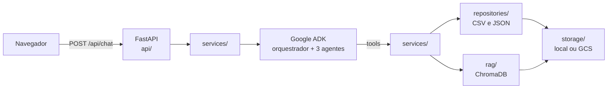

# Sabor da Terra

**Assistente inteligente para gestão de cooperativa agrícola.**

Projeto intermediário da formação em IA Generativa e Agentes (Universidade de Pernambuco, Campus Garanhuns, em parceria com a Sauter Tecnologia). O desafio é construir um assistente de IA para a Cooperativa Sabor da Terra, uma cooperativa **fictícia** de produtores rurais do Agreste Meridional de Pernambuco.

---

## O problema

A Sabor da Terra reúne 180 pequenos produtores em 12 municípios e vende frutas, hortaliças, queijos artesanais e mel para restaurantes, mercados e programas governamentais (PNAE, PAA). Nos últimos dois anos a demanda cresceu 40%, mas a operação continua artesanal. Há três gargalos:

| Gargalo | Situação atual |
|---|---|
| **Triagem de pedidos** | Chegam de 60 a 100 pedidos por dia, por e-mail, formulário e mensagem, quase sempre em texto livre. Dois funcionários gastam o dia inteiro cruzando cada pedido com a disponibilidade dos produtores, e erros de alocação geram perda de produtos perecíveis |
| **Consulta documental** | Certificações, laudos, fichas técnicas e contratos ficam em pastas físicas e digitais. Responder "quais produtores têm certificação orgânica vigente para mel?" leva horas |
| **Comunicação com produtores** | Vendas do mês, pendências financeiras e avisos de novos pedidos são repassados por telefone, um a um |

## A solução

Um assistente conversacional com um **agente principal** que delega a três **agentes especializados**:

| Agente | O que faz |
|---|---|
| **Pedidos** | Interpreta pedidos em português coloquial, extrai produtos, quantidades, prazos e comprador, classifica por tipo e urgência e sinaliza problemas (fora de safra, quantidade acima da capacidade) |
| **Documentos** | Responde perguntas sobre certificações, contratos, fichas técnicas e lotes com base nos documentos reais (RAG), **citando a fonte** e dizendo claramente quando não encontra a informação |
| **Produtores** | Gera resumos individuais (vendas, pedidos alocados, pendências) e redige notificações |

Princípio central: **o modelo de linguagem interpreta; o código verifica.** Alertas como "produto fora de safra" são calculados por regras determinísticas, não pelo palpite do modelo.

## Arquitetura



A organização detalhada de cada pasta e arquivo, o fluxo de uma mensagem, as decisões e as limitações estão em **[`docs/ESTRUTURA.md`](docs/ESTRUTURA.md)**.

### Stack

| Camada | Tecnologia |
|---|---|
| Backend | Python 3.12, FastAPI, Uvicorn |
| IA | Google ADK, Gemini |
| Consulta documental | RAG com ChromaDB (PDF e DOCX) |
| Frontend | HTML5, CSS3 e JavaScript puro |
| Dados | CSV e JSON (estruturados), PDF e DOCX (documentos) |
| Armazenamento | Local, com interface pronta para Google Cloud Storage |

## Estrutura do repositório

| Pasta | Função |
|---|---|
| `api/` | Rotas HTTP: recebe e devolve JSON |
| `models/` | Schemas Pydantic (contratos de dados) |
| `services/` | Regras de negócio |
| `agents/` | Agentes do Google ADK: orquestrador, especialistas, prompts e ferramentas |
| `rag/` | Carga de documentos, chunking, embeddings e busca |
| `repositories/` | Acesso a dados estruturados (CSV/JSON) |
| `storage/` | Interface de armazenamento: local hoje, GCS no futuro |
| `data/` | Dados e documentos da cooperativa |
| `static/` | Frontend |
| `utils/` | Configuração e logging |
| `tests/` | Testes automatizados |
| `docs/` | Documentação de arquitetura |

## Como executar (Windows / PowerShell)

Pré-requisito: Python 3.12 (`py -3.12 --version`).

```powershell
# 1. Criar e ativar o ambiente virtual
py -3.12 -m venv .venv
.\.venv\Scripts\Activate.ps1
# Se o PowerShell bloquear o script, libere só nesta janela:
#   Set-ExecutionPolicy -Scope Process -ExecutionPolicy Bypass

# 2. Instalar as dependências (núcleo + testes)
python -m pip install --upgrade pip
pip install -e ".[dev]"

# 3. Criar o arquivo de configuração
Copy-Item .env.example .env

# 4. Subir o servidor (sempre a partir da pasta do projeto)
uvicorn main:app --reload
```

| Endereço | O que é |
|---|---|
| http://127.0.0.1:8000 | Interface web |
| http://127.0.0.1:8000/docs | Documentação interativa da API |
| http://127.0.0.1:8000/api/health | Verificação de saúde |

```powershell
Invoke-RestMethod http://127.0.0.1:8000/api/health   # verificar pelo terminal
pytest                                               # rodar os testes
```

Dependências das próximas fases (instale quando chegar a vez delas):

```powershell
pip install -e ".[ai]"    # Google ADK (agentes)
pip install -e ".[rag]"   # ChromaDB, pypdf, python-docx
pip install -e ".[gcs]"   # Google Cloud Storage (migração futura)
```

### Configuração (`.env`)

| Variável | Para que serve |
|---|---|
| `GOOGLE_API_KEY` | Chave do [Google AI Studio](https://aistudio.google.com/apikey). Necessária a partir da fase dos agentes |
| `MODEL` | Nome do modelo Gemini ([lista vigente](https://ai.google.dev/gemini-api/docs/models)) |
| `STORAGE_BACKEND` | `local` (padrão). `gcs` ainda não está implementado |
| `DATA_DIR` | Pasta dos dados (padrão `data`) |
| `VECTOR_STORE_DIR` | Pasta do índice ChromaDB (padrão `.vectorstore`) |
| `APP_ENV`, `LOG_LEVEL` | Ambiente e nível de log |

O `.env` está no `.gitignore` e **nunca** deve ser enviado ao GitHub.

## Status

| Fase | Entrega | Situação |
|---|---|---|
| 1 | Fundação: FastAPI, configuração, `/api/health`, storage local, frontend mínimo | Concluída |
| 2 | Estrutura completa e documentação | Concluída |
| 3 | Dados e repositórios | Pendente (aguarda os arquivos de `data/`) |
| 4 | Orquestrador, Agente de Pedidos e API de chat | Pendente |
| 5 | RAG e Agente de Documentos | Pendente |
| 6 | Agente de Produtores, relatórios e notificações | Pendente |
| 7 | Interface de chat | Pendente |

Hoje a aplicação sobe, responde em `/api/health`, serve o frontend e já possui a camada de armazenamento. Os agentes, o RAG e as regras da cooperativa ainda **não** estão implementados: os arquivos existem como esqueletos documentados.

## Datas do projeto

| Data | Evento |
|---|---|
| 05/11/2026 | Divulgação da formação dos grupos |
| 19/11/2026 | Entrega obrigatória da arquitetura do projeto |
| 20/11/2026 a 21/11/2026 | Apresentação e demonstração do protótipo funcional |

## Limitações conhecidas

Sessões em memória (reiniciar o servidor apaga o contexto), sem autenticação, pedidos somente leitura, notificações apenas redigidas (não enviadas). A lista completa e as decisões em aberto estão em [`docs/ESTRUTURA.md`](docs/ESTRUTURA.md).

## Dados

Todos os dados da cooperativa são **fictícios**, fornecidos no enunciado. Veja [`data/README.md`](data/README.md).
