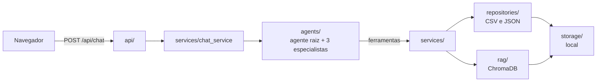

# Sabor da Terra

**Assistente inteligente para gestão de cooperativa agrícola.**

Projeto intermediário da formação em IA Generativa e Agentes (Universidade de Pernambuco, Campus Garanhuns, em parceria com a Sauter Tecnologia). O desafio é construir um assistente de IA para a Cooperativa Sabor da Terra, uma cooperativa **fictícia** de produtores rurais do Agreste Meridional de Pernambuco.

---

## 1. Descrição e objetivo

A Sabor da Terra reúne 180 pequenos produtores em 12 municípios e vende frutas, hortaliças, queijos artesanais e mel para restaurantes, mercados e programas governamentais (PNAE, PAA). A operação ainda é artesanal e tem três gargalos:

| Gargalo | Situação atual |
|---|---|
| **Triagem de pedidos** | Chegam de 60 a 100 pedidos por dia, em texto livre. Dois funcionários cruzam cada pedido com a disponibilidade dos produtores. |
| **Consulta documental** | Certificações, laudos, fichas técnicas e contratos ficam em pastas. Responder "quais produtores têm certificação orgânica vigente para mel?" leva horas. |
| **Comunicação com produtores** | Vendas do mês, pendências financeiras e avisos de pedidos são repassados por telefone, um a um. |

**Objetivo:** um assistente conversacional com um agente principal que delega a três agentes especializados (pedidos, documentos e produtores).

Princípio central: **o modelo de linguagem interpreta; o código verifica.** Alertas como "produto fora de safra" ou "quantidade acima da capacidade" vêm de regras determinísticas, não do palpite do modelo.

## 2. Funcionalidades implementadas

- **Chat** (`POST /api/chat`) com sessão em memória, lista de agentes usados e fontes documentais.
- **Agente de Pedidos:** interpreta pedido em português coloquial, resolve o prazo, classifica **tipo** e **urgência** e devolve alertas (fora de safra, quantidade acima da capacidade, unidade divergente, informação ausente ou ambígua).
- **Agente de Documentos:** responde com base nos documentos da cooperativa via RAG, cita o arquivo (e a página, quando existe) e diz quando não há evidência.
- **Agente de Produtores:** resumo de vendas, pedidos e pendências financeiras de um produtor e dados para redigir uma notificação.
- **Pipeline RAG:** carga, divisão em trechos, embeddings, índice no ChromaDB e busca.
- **Frontend** de chat em HTML/CSS/JavaScript puro (fundo branco, acento verde), com estados de carregamento e de erro.
- **Tratamento de erros do chat:** 422 (corpo inválido), 429 (limite de requisições da IA), 503 (IA não configurada ou chave recusada) e 502 (falha do assistente).

## 3. Tecnologias

| Camada | Tecnologia |
|---|---|
| Backend | Python 3.12, FastAPI, Uvicorn, Pydantic v2, pydantic-settings |
| IA | Google ADK (2.x) e Gemini (`gemini-3.5-flash-lite`, configurável por `MODEL`) |
| RAG | ChromaDB, embeddings `gemini-embedding-001`, pypdf, python-docx |
| Frontend | HTML5, CSS3 e JavaScript puro |
| Dados | CSV e JSON (estruturados); TXT, PDF e DOCX (documentos) |
| Armazenamento | Local; a interface permite trocar por Google Cloud Storage no futuro |
| Testes | pytest (com anyio) e Node.js para a lógica do frontend |

## 4. Arquitetura



Camadas: `api` → `chat_service` → `agents` → `tools` → `services` → `repositories` / `rag` → `storage`. Detalhes, diagramas e decisões técnicas: [`docs/ARQUITETURA_E_DECISOES_TECNICAS.md`](docs/ARQUITETURA_E_DECISOES_TECNICAS.md). Estrutura de arquivos: [`docs/ESTRUTURA.md`](docs/ESTRUTURA.md).

## 5. Estrutura de diretórios

| Pasta | Função |
|---|---|
| `api/` | Rotas HTTP (`chat_controller` e `health_controller` em uso; os demais controllers são esqueletos opcionais) |
| `models/` | Schemas Pydantic (contratos de dados) |
| `services/` | Regras de negócio, triagem e camada do chat |
| `agents/` | Agente raiz, especialistas (`subagents/`), prompts e ferramentas |
| `rag/` | Carga de documentos, chunking, índice vetorial, ingestão e busca |
| `repositories/` | Acesso aos dados estruturados e aos documentos |
| `storage/` | Interface de armazenamento (local implementado; `gcs_storage.py` é esqueleto) |
| `data/` | Dados e documentos da cooperativa (ver [`data/README.md`](data/README.md)) |
| `static/` | Frontend |
| `utils/` | Configuração e logging |
| `tests/` | Testes automatizados (pytest) |
| `qa/` | Verificações de QA do frontend (`test_logica.js`, `mock_server.py`, `verificar_backend.py`) |
| `docs/` | Documentação |

## 6. Módulos principais

| Módulo | Responsabilidade |
|---|---|
| `agents/agent.py` | Cria o agente raiz e registra os especialistas |
| `agents/subagents/` | `pedidos_agent`, `documentos_agent`, `produtores_agent` |
| `agents/tools.py` | Ferramentas que os agentes chamam; todas delegam a serviços |
| `services/triagem_service.py` | Prazo, urgência, tipo e ausências do pedido |
| `services/pedido_service.py` | Fatos verificáveis: safra, capacidade, preço |
| `services/documento_service.py` | Consulta documental com fontes |
| `services/produtor_service.py`, `relatorio_service.py` | Dossiê do produtor e relatórios |
| `services/chat_service.py` | Sessão, execução do agente, fontes e erros |
| `rag/` | `document_loader`, `chunker`, `vector_store`, `ingestion`, `retriever` |

## 7. Fluxo dos agentes

1. O navegador envia `message` (e, opcionalmente, `user_id` e `session_id`) para `POST /api/chat`.
2. O `chat_service` executa o agente raiz do Google ADK na sessão informada.
3. O agente raiz delega ao especialista adequado (cada especialista é uma `AgentTool`); o especialista recebe apenas o texto da chamada.
4. O especialista chama ferramentas, que consultam os serviços; o LLM nunca lê arquivos diretamente.
5. A resposta volta com `answer`, `session_id`, `agents_used`, `sources` e `status`.

Detalhes de agentes, ferramentas e prompts: [`docs/AGENTES_E_TRIAGEM.md`](docs/AGENTES_E_TRIAGEM.md).

## 8. Triagem de pedidos

A triagem combina interpretação do modelo com verificações em código:

- **Prazo:** data explícita prevalece; datas relativas são resolvidas com a data atual; prazo ambíguo gera pergunta ao usuário.
- **Urgência:** `urgente` (até 2 dias ou sinalizada), `normal` (3 a 14 dias), `planejado` (mais de 14 dias) ou `indefinida`.
- **Tipo:** `pedido_firme`, `cotacao`, `fornecimento_recorrente` ou `nao_e_pedido`.
- **Verificações:** safra, capacidade (limite informado ou maior lote histórico) e valor estimado; quando as unidades divergem, o valor não é estimado.
- **Ausências:** o que falta é listado (unidade, prazo, conversão de unidade, capacidade não comprovada).

O vocabulário de tipo/urgência e os limiares são uma **proposta** que a equipe ainda deve validar.

## 9. RAG

- Documentos em `data/certificacoes`, `data/contratos` e `data/fichas_tecnicas`.
- Chunks de 1000 caracteres com sobreposição de 150.
- Ingestão separada e idempotente: `python -m rag.ingestion` (substitui os trechos de cada documento e continua se um falhar).
- Busca por similaridade de cosseno (top-k 5, máximo 8) com distância máxima 0,30; sem trecho dentro do limite, o assistente informa que não há evidência.
- O índice (`.vectorstore/`) **não é versionado** e precisa ser construído em cada ambiente. A construção chama a API de embeddings do Google.

## 10. Configuração do ambiente (Windows / PowerShell)

Pré-requisito: Python 3.12 (`py -3.12 --version`) e Node.js (apenas para os testes do frontend).

## 11. Instalação

```powershell
py -3.12 -m venv .venv
.\.venv\Scripts\Activate.ps1
# Se o PowerShell bloquear o script, libere só nesta janela:
#   Set-ExecutionPolicy -Scope Process -ExecutionPolicy Bypass

python -m pip install --upgrade pip
pip install -e ".[dev,ai,rag]"

Copy-Item .env.example .env
```

## 12. Variáveis de ambiente

Definidas em `.env` (modelo em `.env.example`, que deve permanecer sem segredos):

| Variável | Para que serve |
|---|---|
| `APP_ENV`, `LOG_LEVEL` | Ambiente e nível de log |
| `GOOGLE_API_KEY` | Chave do [Google AI Studio](https://aistudio.google.com/apikey). Sem ela o chat responde 503 |
| `MODEL` | Modelo Gemini dos agentes (padrão `gemini-3.5-flash-lite`) |
| `STORAGE_BACKEND` | `local` (padrão). `gcs` ainda não está implementado |
| `DATA_DIR` | Pasta dos dados (padrão `data`) |
| `GCS_BUCKET`, `GCS_PREFIX` | Reservadas para o GCS |
| `VECTOR_STORE_DIR` | Pasta do índice ChromaDB (padrão `.vectorstore`) |

O `.env` está no `.gitignore` e **nunca** deve ser enviado ao GitHub. A chave gratuita (Free Tier) tem limite baixo de requisições por minuto; ao excedê-lo o chat responde 429.

## 13. Executar o backend

```powershell
uvicorn main:app --reload
```

| Endereço | O que é |
|---|---|
| http://127.0.0.1:8000 | Interface web |
| http://127.0.0.1:8000/docs | Documentação interativa da API |
| http://127.0.0.1:8000/api/health | Verificação de saúde |

Para habilitar consultas documentais, construa o índice uma vez (usa a API de embeddings): `python -m rag.ingestion`.

## 14. Executar os testes

```powershell
$env:GOOGLE_API_KEY = ""   # garante que nenhum teste chame a API real
pytest
node qa/test_logica.js     # lógica do frontend
```

Os testes dos agentes usam um LLM simulado (`tests/llm_simulado.py`). Não há teste automatizado que dependa do Gemini real.

## 15. Equipe

| Integrante | Papel |
|---|---|
| Murilo | Líder técnico e arquitetura |
| Rawan | Dados e RAG |
| David | Agentes e IA |
| Arthur | Backend e dados |
| Raquel | Interface e QA |

Plano de trabalho por integrante: [`docs/PLANO_DE_TAREFAS.md`](docs/PLANO_DE_TAREFAS.md).

## 16. Documentação

| Documento | Conteúdo |
|---|---|
| [`docs/ARQUITETURA_E_DECISOES_TECNICAS.md`](docs/ARQUITETURA_E_DECISOES_TECNICAS.md) | Arquitetura, diagramas e decisões |
| [`docs/ESTRUTURA.md`](docs/ESTRUTURA.md) | Pastas, arquivos e fluxo |
| [`docs/PLANO_DE_TAREFAS.md`](docs/PLANO_DE_TAREFAS.md) | Tarefas por integrante |
| [`docs/AGENTES_E_TRIAGEM.md`](docs/AGENTES_E_TRIAGEM.md) | Agentes, ferramentas e triagem |
| [`docs/CONTRATOS_ARQUITETURAIS.md`](docs/CONTRATOS_ARQUITETURAIS.md) | Contratos entre camadas |
| [`docs/CONEXAO_BACKEND.md`](docs/CONEXAO_BACKEND.md) | Contrato HTTP do chat |
| [`docs/DADOS.md`](docs/DADOS.md) | Dados da cooperativa |
| [`docs/QA_CHECKLIST.md`](docs/QA_CHECKLIST.md), [`docs/TESTE_USABILIDADE.md`](docs/TESTE_USABILIDADE.md) | QA e usabilidade |

## 17. Limitações e pendências

- **Sem validação ampla com o Gemini real:** apenas 5 cenários de pedidos foram testados com a API; documentos e produtores foram validados só com LLM simulado.
- **Índice RAG não construído por padrão** e distância máxima (0,30) ainda não calibrada com perguntas reais.
- **Sessões em memória:** reiniciar o servidor perde o contexto; `session_id` desconhecido inicia uma nova sessão.
- **Sem autenticação** nem controle de acesso; as recusas de consultas em primeira pessoa de produtores são feitas pelos prompts.
- **Pedidos triados não são gravados.** A persistência depende de decisão da equipe.
- **Alertas** ainda vão no texto da resposta; não há campo estruturado `alerts`.
- **Google Cloud Storage** e os controllers opcionais de pedidos, documentos e produtores são esqueletos.
- **Nomes dos campos do chat** (`message`, `user_id`/`user`) aguardam confirmação do líder técnico.
- **Evidências visuais** (`docs/evidencias/` e o relatório do frontend) são do visual anterior.
- Prazos: entrega da arquitetura em 19/11/2026; demonstração em 20 e 21/11/2026.
