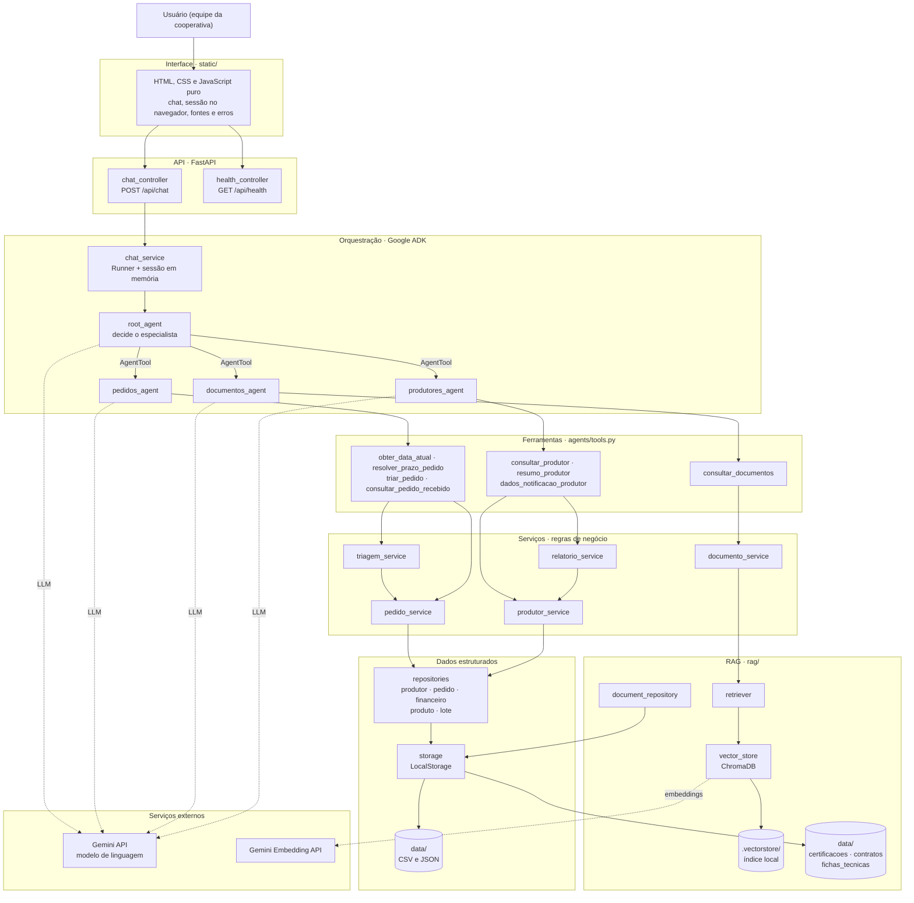
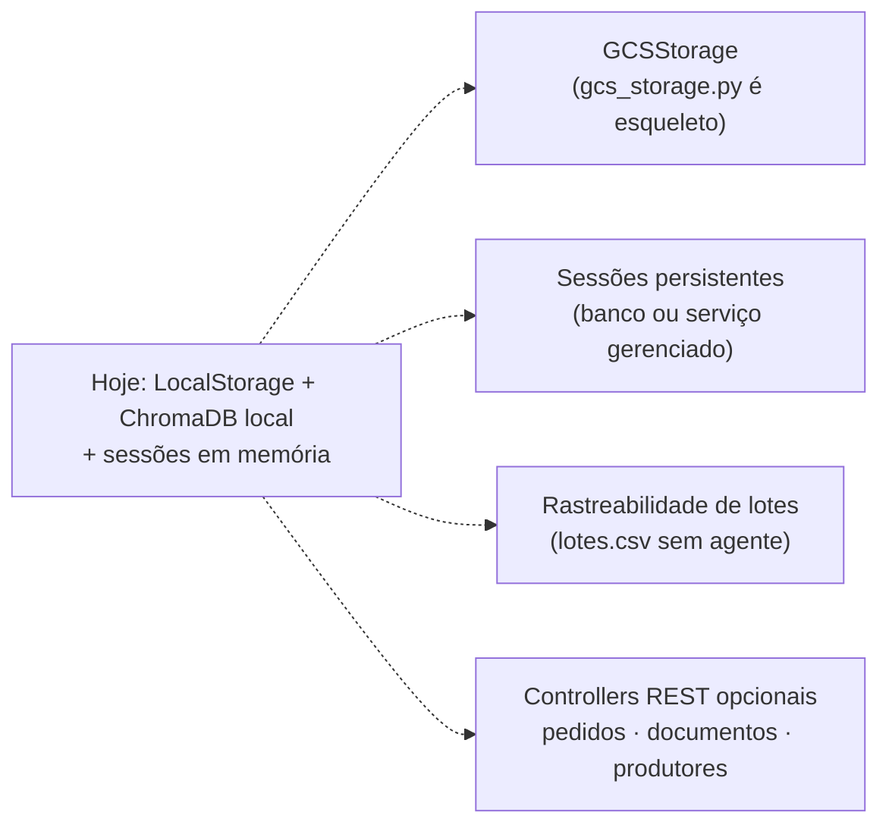
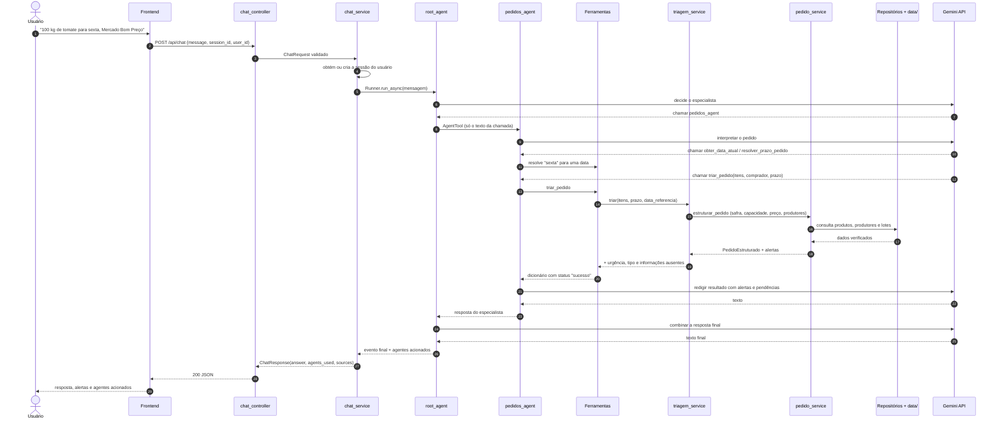
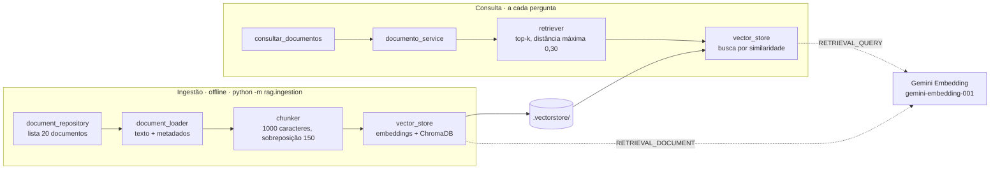

# Arquitetura e decisões técnicas

Este documento explica como o Sabor da Terra foi arquitetado, como uma mensagem percorre o sistema e por que as principais decisões foram tomadas. Ele descreve **o que está implementado em 19/11/2026**; o que é apenas planejado aparece sempre identificado como tal.

Documentos relacionados: [`ESTRUTURA.md`](ESTRUTURA.md) (árvore e função de cada arquivo), [`CONTRATOS_ARQUITETURAIS.md`](CONTRATOS_ARQUITETURAIS.md) (contratos entre camadas), [`AGENTES_E_TRIAGEM.md`](AGENTES_E_TRIAGEM.md) (agentes e triagem em detalhe), [`DADOS.md`](DADOS.md) (dicionário de dados) e [`PLANO_DE_TAREFAS.md`](PLANO_DE_TAREFAS.md).

> **Sobre as justificativas.** Quando a motivação de uma decisão está registrada no repositório, a fonte é citada. Quando não está, o texto traz a **justificativa técnica da arquitetura atual** e marca como *análise*: não é um relato histórico do que a equipe discutiu.

---

## 1. Visão geral da arquitetura

O sistema é um assistente conversacional para a equipe da Cooperativa Sabor da Terra. Uma pessoa escreve uma mensagem em português; um **agente orquestrador** decide qual **agente especialista** deve tratá-la (pedidos, documentos ou produtores); o especialista usa **ferramentas** que chamam **serviços** com regras determinísticas, que leem **repositórios** (CSV/JSON) ou o **índice vetorial** (RAG). O modelo de linguagem interpreta e redige; o código verifica os fatos.



*Diagrama da arquitetura atual. Setas contínuas são chamadas de código; setas tracejadas são chamadas a serviços externos. Os modelos Pydantic (`models/`) e a configuração (`utils/`) são usados por todas as camadas e não foram desenhados para não poluir o diagrama. A ingestão do índice é um processo offline, mostrado na seção 9.*

### Evolução planejada (**não implementada**)



---

## 2. Objetivo de cada camada

A regra de dependência é: **cada camada só conhece a de baixo**. Na prática, a camada web não sabe como o agente raciocina, o agente não sabe que existe HTTP, e nada fora de `storage/` conhece caminhos físicos de arquivos (`ESTRUTURA.md`, seção 1; `CONTRATOS_ARQUITETURAIS.md`, seção 1).

| Camada | Pasta | Objetivo |
|---|---|---|
| Interface | `static/` | Receber a mensagem, mostrar a resposta, as fontes, os agentes acionados e os erros |
| API | `api/` | Validar a requisição, chamar o serviço e traduzir falhas em HTTP |
| Orquestração | `services/chat_service.py`, `agents/agent.py` | Manter a sessão e decidir qual especialista atua |
| Agentes | `agents/subagents/`, `agents/prompts.py` | Interpretar linguagem natural e redigir a resposta |
| Ferramentas | `agents/tools.py` | Adaptar o que o modelo pede em chamadas de serviço |
| Serviços | `services/` | Regras de negócio determinísticas |
| Repositórios | `repositories/` | Ler CSV/JSON e devolver modelos |
| RAG | `rag/` | Indexar e recuperar trechos de documentos |
| Armazenamento | `storage/` | Esconder onde os arquivos estão |
| Modelos | `models/` | Contratos de dados validados (Pydantic) |
| Transversal | `utils/` | Configuração e logging |

---

## 3. Responsabilidades dos módulos

A função detalhada de cada arquivo está em [`ESTRUTURA.md`](ESTRUTURA.md), seção 4. Resumo do que **não** cada camada deve fazer, que é o que mantém o desenho coeso:

- **API** não tem regra de negócio nem conhece o ADK.
- **Agentes** não leem arquivos, não calculam valores nem conhecem HTTP.
- **Ferramentas** não reproduzem regra de negócio nem acessam repositórios (há um teste que falha se `agents/tools.py` importar `repositories`, `storage`, `rag` ou `chromadb`).
- **Serviços de domínio** não dependem dos agentes. A exceção arquitetural é o `chat_service`, que existe justamente para integrar a API ao ADK.
- **Repositórios** não decidem regras (o repositório informa a disponibilidade de um produto; quem decide se um pedido é viável é o serviço).

---

## 4. Comunicação entre frontend e backend

O frontend é servido pelo próprio FastAPI (`main.py` monta `static/` na mesma origem), então **não há CORS**. A tela consulta `GET /api/health` ao abrir e envia as mensagens por `POST /api/chat`.

| | Campos |
|---|---|
| Requisição | `message` (1 a 4000 caracteres), `session_id` (opcional), `user_id` (alias aceito: `user`) |
| Resposta | `answer`, `session_id`, `agents_used`, `sources` (`source`, `page`), `status` |
| Erros | `{"detail": "..."}` com **422** (corpo inválido), **429** (limite de requisições da IA), **503** (IA não configurada ou chave recusada), **502** (falha do assistente) |

O navegador guarda o `session_id` e um `user_id` anônimo; a conversa sobrevive a recarregar a página. O frontend **não recebe alertas como campo estruturado**: os alertas da triagem vêm dentro do texto de `answer` (a tela já sabe exibir `alerts` quando o backend passar a enviá-los). Os nomes dos campos foram adotados na implementação e **aguardam confirmação do Murilo** (`CONTRATOS_ARQUITETURAIS.md`, seção 10.1). Roteiro de verificação em [`CONEXAO_BACKEND.md`](CONEXAO_BACKEND.md).

---

## 5. Fluxo de entrada e processamento de uma solicitação



Pontos que importam:

1. **A sessão pertence ao `chat_service`.** Um `session_id` desconhecido ou de outro usuário gera uma sessão nova, devolvida na resposta (isolamento entre usuários).
2. **O especialista não vê o histórico.** Recebe somente o texto da chamada; se um dado de turnos anteriores for necessário, o orquestrador o inclui explicitamente (contrato, seção 2.1).
3. **Cada mensagem custa de 4 a 6 chamadas ao modelo** (orquestrador, especialista e suas ferramentas). Isso importa para o limite do Free Tier (seção 15).

---

## 6. Agente principal e subagentes

**`root_agent`** (`agents/agent.py`) recebe a mensagem, identifica a intenção e chama um ou mais especialistas como ferramentas. Ele não consulta dados. Sua instrução é **montada a partir dos especialistas realmente registrados**, então o prompt nunca promete uma capacidade que não existe. Se a pergunta não tem especialista, ele diz isso. Mensagens em primeira pessoa de um produtor sobre os próprios valores **não** são encaminhadas (seção 13).

| Especialista | Faz | Ferramentas |
|---|---|---|
| `pedidos_agent` | Interpreta pedidos coloquiais, extrai itens/prazo/comprador, apresenta a triagem | `obter_data_atual`, `resolver_prazo_pedido`, `triar_pedido`, `consultar_pedido_recebido` |
| `documentos_agent` | Responde só com o que os trechos recuperados dizem, citando a fonte; admite quando não encontra | `obter_data_atual`, `consultar_documentos` |
| `produtores_agent` | Resumos individuais e **rascunhos** de notificação (não envia nada) | `obter_data_atual`, `consultar_produtor`, `resumo_produtor`, `dados_notificacao_produtor` |

**Contrato de plug-in.** O `root_agent` registra todo módulo de `agents/subagents/` que exponha `criar_<nome>_agent(model=None) -> Agent`. Um especialista novo entra sem alterar o orquestrador; um ausente é ignorado com um aviso no log. Os prompts ficam todos em `agents/prompts.py` (sem chaves `{}` literais, que o ADK trataria como variáveis de estado).

---

## 7. Ferramentas e serviços

**Ferramentas** (`agents/tools.py`) são funções Python tipadas cuja **docstring é o que o modelo lê** para decidir quando usá-las. Convenções:

- Devolvem um dicionário com `status` (`"sucesso"` ou `"erro"`) e, no erro, uma mensagem sem caminhos nem detalhes internos.
- **Todo parâmetro tem valor padrão.** No ADK 2.x um argumento obrigatório omitido pelo modelo gera `TypeError` e derruba a conversa; com padrão, a ferramenta devolve um erro que orienta o modelo a corrigir a chamada.
- Erros esperados (entrada inválida, dado inexistente, falha de leitura) viram `status: "erro"`; falhas inesperadas propagam para a retentativa e a telemetria do ADK.
- Saídas enxutas: sem CPF, conta bancária ou telefone, e sem o texto original dos pedidos.

**Serviços** concentram as regras:

| Serviço | Responsabilidade |
|---|---|
| `pedido_service` | Catálogo, safra, preço, desconto de atacado, produtores elegíveis, certificação, capacidade, restrições sanitárias |
| `triagem_service` | Prazo, urgência, tipo e informações ausentes; reutiliza o `pedido_service` |
| `documento_service` | Consulta documental com limiar de distância e fontes citáveis |
| `produtor_service` | Cadastro, certificação, transações, lotes e pedidos de um produtor |
| `relatorio_service` | Totais, pendências e dados para notificação |
| `chat_service` | Sessão e execução do agente |

---

## 8. Triagem de pedidos

A triagem separa **interpretação** (do modelo) de **verificação** (do código).

1. **O modelo extrai** do texto: comprador, itens (produto, quantidade, unidade, orgânico), prazo como foi escrito e tipo. Quantidade só existe se estiver escrita: "umas caixas de goiaba" fica **sem quantidade** e gera pergunta.
2. **O prazo vira data por código** (`resolver_prazo`), nunca por cálculo do modelo. Data explícita vence qualquer pista (`sexta (01/nov)` → 01/11); `hoje`, `amanhã` e dias da semana viram datas; **"semana que vem", "o quanto antes" e o mesmo dia da semana de hoje são ambíguos** e geram pergunta; datas ISO (`AAAA-MM-DD`) também são aceitas.
3. **O `pedido_service` valida cada item**: existência no catálogo (com normalização de nomes), nível de safra no mês de entrega (`fora_de_safra`, `baixa_disponibilidade`), restrição sanitária (sem SIE) e exclusividade de produtor, produtores ativos e certificação orgânica vigente, preço convencional/orgânico com desconto de atacado, e **capacidade** pela regra híbrida (limite explícito nas observações ou maior lote histórico). Sem nenhuma das duas referências, o sistema **não afirma capacidade** (`capacidade_nao_comprovada`).
4. **O `triagem_service` completa**: urgência, tipo validado e informações ausentes (`comprador`, `prazo`, `quantidade:<produto>`, `unidade:<produto>`, `prazo_ambiguo`, `prazo_no_passado`, `conversao_unidade:<produto>`, `capacidade_nao_comprovada:<produto>`).
5. **Unidade diferente da tabela de preços** (ex.: "caixas" × kg): não há fator de conversão nos dados, então o item fica **sem valor estimado** em vez de tratar "10 caixas" como "10 kg".
6. **O agente apresenta** o resultado: resumo, itens, produtores elegíveis, alertas e pendências. Ele **nunca confirma, reserva nem aloca** um pedido.

Classificação (proposta implementada, **a validar com a equipe**):

| Urgência | Regra |
|---|---|
| `urgente` | Entrega em até 2 dias, ou o comprador declarou urgência |
| `normal` | De 3 a 14 dias |
| `planejado` | Mais de 14 dias |
| `indefinida` | Sem prazo, prazo ambíguo ou no passado |

Tipos: `pedido_firme`, `cotacao`, `fornecimento_recorrente`, `nao_e_pedido` (vocabulário derivado da leitura das 15 mensagens de `pedidos.json`; o modelo escolhe, o código só aceita esses valores).

---

## 9. RAG e recuperação de informações



- **Ingestão** é um processo separado e repetível (`python -m rag.ingestion`), não roda a cada pergunta. O índice (`.vectorstore/`) é um artefato derivado, **não versionado**: cada máquina precisa gerá-lo, e isso usa a API de embeddings.
- **Consulta**: o `documento_service` pede ao `retriever` os 5 trechos mais próximos (máximo 8) e descarta os com distância acima de **0,30** (o mesmo valor usado nos testes de qualidade do retriever). Sem nenhum trecho, o resultado é **evidência insuficiente** e o agente diz que não encontrou.
- **Metadados** preservados: `source` (documento), `document_type`, `page` e `chunk_index`. O loader grava `page = 1` para `.txt`, mas arquivo de texto não tem páginas e o contrato manda não inventar número; por isso o `documento_service` **omite a página de `.txt`** e preserva a de PDF/DOCX.
- **Fontes estruturadas**: a ferramenta grava as fontes no estado da sessão (o ADK encaminha o estado do especialista à sessão do orquestrador) e o `chat_service` as devolve em `sources`, zeradas a cada turno.
- **Segurança**: o conteúdo dos trechos é tratado como **dado**; instruções vindas de documentos não são seguidas.
- **Não coberto**: rastreabilidade de lotes (`lotes.csv` não tem agente).

---

## 10. Organização dos dados, modelos e repositórios

`data/` guarda 6 arquivos estruturados (`produtores.csv`, `pedidos.json`, `financeiro.csv`, `sazonalidade.csv`, `tabela_precos_outubro_2026.csv`, `lotes.csv`) e 20 documentos `.txt` em `certificacoes/`, `contratos/` e `fichas_tecnicas/`. Todos fictícios, usados sem edição; anomalias conhecidas (nomes de produto diferentes entre arquivos, unidades misturadas em `quantidade_kg`, atraso que depende de uma data de referência) estão em [`DADOS.md`](DADOS.md).

| Modelo (`models/`) | Representa |
|---|---|
| `pedido_model` | Pedido bruto, item de entrada, item validado, alertas e pedido estruturado |
| `produtor_model` | Produtor **público** (sem CPF nem dados bancários), transação, lote |
| `produto_model` | Sazonalidade e preços |
| `relatorio_model` | Dossiê, relatório e dados de notificação |
| `documento_model` | Trecho recuperado, fonte citável e resultado da consulta |
| `chat_model` | Requisição e resposta do chat |

Cada repositório lê um arquivo via `Storage`, converte as linhas em modelos e não aplica regra de negócio: `produtor`, `pedido` (somente leitura), `financeiro`, `produto` (safra, preços e mapa de nomes), `lote` e `document`. O `storage_repository` contém o parsing genérico de CSV/JSON e **não** é o mesmo que `storage/`.

---

## 11. Persistência local e evolução para Google Cloud Storage

Hoje tudo é local: `LocalStorage` lê `DATA_DIR` e **recusa chaves que saiam da raiz** (`../.env`); o índice vive em `.vectorstore/`; as sessões ficam em memória; **nenhum dado é gravado** (pedidos triados e notificações não são persistidos).

Os componentes pedem arquivos por **chave lógica** (`contratos/arquivo.txt`) à interface `Storage` (`storage/base.py`: `exists`, `read_bytes`, `read_text`, `list_keys`). `STORAGE_BACKEND=gcs` selecionaria o `GCSStorage`, que **hoje é um esqueleto** e levanta `NotImplementedError`. Migrar para a nuvem envolve quatro peças diferentes (`ESTRUTURA.md`, seção 7):

| Peça | Hoje | Na nuvem (**planejado, não implementado**) |
|---|---|---|
| Arquivos | `LocalStorage` | `GCSStorage` (implementar um arquivo) |
| Índice vetorial | ChromaDB em `.vectorstore/` | Reconstruir pela ingestão a partir do bucket ou persistir em volume; **o bucket não substitui o banco vetorial** |
| Sessões | Em memória | Serviço de sessão persistente |
| Logs | `utils/logger.py` | Cloud Logging |

---

## 12. Tratamento de erros e validações

| Camada | Estratégia |
|---|---|
| Modelos | Pydantic valida tipos e limites; entrada inválida vira 422 |
| Ferramentas | Argumentos ausentes ou inválidos viram `{"status": "erro", ...}` que orienta o modelo; falha de leitura de dados vira erro sem expor caminhos |
| Serviços | Levantam `ValueError` para entrada inválida; não escondem falhas que comprometam o resultado |
| `chat_service` | Converte falhas em exceções tipadas: `ChatIndisponivelError` (IA não configurada ou chave recusada), `ChatLimiteError` (429 da API) e `ChatFalhaError`; no limite do serviço registra só o **tipo** da exceção |
| Controller | Mapeia para 503, 429 e 502 com mensagens curtas, sem detalhes internos |
| Agentes | Não transformam falha em informação: ferramenta com erro vira "não consegui consultar", nunca um dado inventado |

O determinismo também é uma validação: safra, capacidade, preço e prazo nunca dependem de o modelo "lembrar" a regra.

---

## 13. Segurança e gerenciamento de credenciais

- **Credenciais:** a chave fica em `GOOGLE_API_KEY` no `.env` (ignorado pelo Git); `.env.example` traz as variáveis **sem valores**. A configuração é lida num único lugar (`utils/config.py`) e a chave é tratada como segredo (`SecretStr`). A chave nunca é registrada em log nem devolvida pela API (`/api/health` só informa se a IA está configurada).
- **Dados pessoais:** os arquivos contêm CPF, dados bancários e data de nascimento (fictícios). Os modelos públicos de produtor não os carregam; as ferramentas omitem CPF no texto de pedidos e não devolvem o texto original de pedidos relacionados; os prompts proíbem repetir dados pessoais; os logs nunca registram o conteúdo das mensagens.
- **Entrada não confiável:** textos de pedidos e de documentos são **dados**, não instruções; os prompts mandam não obedecer instruções contidas neles.
- **Menor privilégio:** as ferramentas só chamam serviços (um teste garante que não importam repositórios nem `storage`); o `LocalStorage` restringe o acesso à pasta de dados; o repositório de documentos só aceita as três categorias.
- **Sem autenticação:** o sistema **não autentica quem escreve**. Para que o assistente não vire um meio de consultar valores de outros produtores, o orquestrador e o `produtores_agent` **recusam** mensagens em primeira pessoa de produtor ("quanto eu vendi", "meu saldo") e orientam procurar a equipe. É uma salvaguarda de prompt, **não um controle de acesso**.

---

## 14. Estratégia de testes

| Nível | O que cobre | Arquivos |
|---|---|---|
| Unidade, regras determinísticas | Triagem, prazos, produtores, relatórios, validações, com os **dados reais** | `test_triagem_service`, `test_pedidos`, `test_produtores` |
| Dados | Modelos, repositórios, storage e parsing | `test_models_dados`, `test_repositories_dados`, `test_storage*` |
| RAG | Chunking, ingestão, vector store, retriever, acervo real | `test_chunker`, `test_ingestion`, `test_vector_store`, `test_retriever*`, `test_document_repository_loader` |
| Ferramentas e prompts | Argumentos ausentes, erros controlados, ausência de dados sensíveis, regras dos prompts | `test_agents_tools`, `test_agents_prompts` |
| Agentes | Delegação, trajetória, sessão e falhas com **LLM simulado** | `test_agents_*`, `llm_simulado.py` |
| Integração | API → `chat_service` → agentes → serviços → repositórios | `test_chat_integracao` |
| Frontend | Arquivos estáticos, tema, decoração; lógica em JS | `test_frontend_estatico`, `qa/test_logica.js` |

**O LLM simulado** substitui apenas o modelo: o `Runner`, o `AgentTool`, as ferramentas, os serviços e os repositórios são os reais. Isso valida a trajetória (quem foi chamado, com quais argumentos, se o resultado real chegou ao modelo e se não houve chamadas extras) sem custo e de forma determinística. **Ele não mede a qualidade da interpretação do Gemini.**

Execução (sem gastar cota):

```powershell
$env:GOOGLE_API_KEY = ""     # impede que 2 testes de QA chamem a API de verdade
pytest
node qa/test_logica.js
```

Testes que dependem de recursos externos ficam ignorados com motivo explícito: qualidade do retriever (exige índice real e `RUN_RETRIEVER_QUALITY=1`), 2 testes de chat que chamam o modelo (exigem chave) e a rastreabilidade de lotes (não implementada). A validação com o **Gemini real** foi feita manualmente em 5 cenários (`AGENTES_E_TRIAGEM.md`, seção 9), não de forma automatizada.

---

## 15. Limitações e possibilidades de evolução

| Limitação | Evolução possível |
|---|---|
| Sessões em memória; reiniciar o servidor apaga o contexto | Serviço de sessão persistente |
| Sem autenticação | Autenticação e autorização por perfil |
| Pedidos triados e notificações não são gravados nem enviados | Estratégia de persistência e canal de envio, com aprovação humana |
| Rastreabilidade de lotes sem agente | Serviço e ferramenta sobre `lotes.csv` e documentos |
| Índice vetorial não versionado e não calibrado (limiar 0,30, chunks 1000/150) | Calibrar com perguntas reais; automatizar a ingestão |
| Free Tier: limite medido de ~15 chamadas por minuto, e cada mensagem usa de 4 a 6 | Plano pago ou fila/espaçamento de mensagens |
| Qualidade da interpretação do Gemini validada em poucos cenários | Avaliação com os 15 pedidos reais e conjuntos de avaliação do ADK |
| Alertas da triagem só no texto | Enviar `alerts` estruturados à interface |
| Controllers REST de pedidos, documentos e produtores são esqueletos | Ativar só se a interface precisar |
| `GCSStorage` é esqueleto | Implementar na migração para a nuvem |

---

## Decisões arquiteturais

Cada decisão indica a **origem**: *documentada* (registrada no repositório, com o arquivo) ou *análise* (justificativa técnica da arquitetura atual, sem registro histórico).

### D1. Arquitetura em camadas com dependência para baixo
- **Problema:** manter agentes, regras, dados e interface independentes e testáveis.
- **Por quê:** a web não precisa saber como o agente raciocina; o agente não precisa saber de HTTP; só `storage/` conhece caminhos físicos. Origem: *documentada* (`ESTRUTURA.md` seção 1; `CONTRATOS_ARQUITETURAIS.md` seção 1).
- **Vantagens:** serviços testáveis sem LLM; troca de armazenamento sem tocar nos agentes.
- **Limitações:** mais arquivos e indireção para um protótipo pequeno.
- **Consequências:** cada mudança de contrato entre camadas deve ser comunicada (contratos, seção 9).

### D2. O LLM interpreta, o código verifica
- **Problema:** os requisitos pedem alertas confiáveis (fora de safra, quantidade acima da capacidade).
- **Por quê:** safra, capacidade, preço e prazo vêm de dados e regras, não do palpite do modelo. Alternativa considerada e rejeitada: deixar o LLM decidir safra e capacidade (*documentada*, `ESTRUTURA.md` seção 9).
- **Vantagens:** resultados reproduzíveis e testáveis; o modelo só faz linguagem.
- **Limitações:** não detecta erro semântico de extração (o modelo entender o pedido errado).
- **Consequências:** regras novas entram como código em `services/`, não como instrução no prompt.

### D3. Especialistas como `AgentTool`, não como `sub_agents`
- **Problema:** perguntas reais cruzam especialistas (ex.: disponibilidade e certificação de um produto).
- **Por quê:** com `AgentTool` o orquestrador continua no comando e combina as respostas. Alternativa: `sub_agents`, que transfere o controle (*documentada*, `ESTRUTURA.md` seção 9).
- **Vantagens:** resposta única e coerente; o especialista não recebe o histórico (menos exposição de dados, contrato 2.1).
- **Limitações:** o especialista só vê o texto da chamada; o orquestrador precisa incluir o contexto necessário. Cada mensagem custa mais chamadas ao modelo.
- **Consequências:** descrições de especialista são o "roteador" e precisam ser específicas.

### D4. Ferramentas finas, com `status` e parâmetros opcionais
- **Problema:** manter a regra fora da ferramenta e evitar que um erro da chamada derrube a conversa.
- **Por quê:** ferramentas são adaptadores (*documentada*, contratos seção 3). Devolver `{"status": "erro"}` em vez de lançar exceção e dar valor padrão a todo parâmetro é *análise* baseada no comportamento do ADK 2.x (argumento ausente gera `TypeError`; exceção inesperada propaga).
- **Vantagens:** o modelo recebe o erro e se corrige; mensagens sem detalhes internos.
- **Limitações:** o esquema deixa de marcar parâmetros como obrigatórios, então a validação fica no código da ferramenta.

### D5. Armazenamento atrás de uma interface
- **Problema:** permitir trocar disco local por Google Cloud Storage sem reescrever serviços.
- **Por quê:** *documentada* (`ESTRUTURA.md` seções 1 e 7). Todos pedem arquivos por chave lógica.
- **Vantagens:** a migração de arquivos é implementar uma classe; o acesso fora da raiz de dados é bloqueado num só lugar.
- **Limitações:** a nuvem não resolve sozinha o índice vetorial, as sessões e os logs (seção 11). `GCSStorage` é esqueleto.

### D6. CSV/JSON via repositórios, sem banco de dados
- **Problema:** dados pequenos e fornecidos como arquivos, em prazo curto.
- **Por quê:** escopo acadêmico; alternativa considerada: SQLite (*documentada*, `ESTRUTURA.md` seção 9). Trocar por banco significaria reescrever apenas os repositórios.
- **Limitações:** sem escrita nem transações; nomes de produto inconsistentes entre arquivos exigem um mapa de normalização.

### D7. ChromaDB local para o RAG
- **Problema:** buscar trechos relevantes em documentos sem operar um serviço vetorial.
- **Por quê:** simples de rodar localmente; alternativa: serviço vetorial gerenciado (*documentada*, `ESTRUTURA.md` seção 9). O `vector_store.py` é o único módulo que conhece o ChromaDB e os embeddings.
- **Limitações:** índice não versionado; cada máquina precisa gerá-lo, usando a API de embeddings.

### D8. Frontend em JavaScript puro, servido pelo FastAPI
- **Problema:** interface simples, sem dependências nem etapa de build.
- **Por quê:** exigência do escopo inicial; alternativa: framework como React (*documentada*, `ESTRUTURA.md` seção 9). A mesma origem elimina CORS.
- **Consequências:** a lógica do chat está em um arquivo grande (`static/js/app.js`), coberta por testes em Node.

### D9. Controllers REST opcionais não ativados
- **Problema:** evitar código que a interface não usa.
- **Por quê:** o fluxo principal passa pelo chat; só se cria o que a interface usar (*documentada*, `ESTRUTURA.md` seção 9). Os três arquivos permanecem como esqueletos.

### D10. Sessões em memória
- **Problema:** manter o contexto da conversa sem infraestrutura adicional.
- **Por quê (*análise*):** o `InMemorySessionService` do ADK não exige banco e basta para o protótipo.
- **Limitações:** reiniciar o servidor apaga o contexto; não escala para várias instâncias.
- **Consequências:** o `chat_service` concentra a gestão de sessão, então trocar o serviço de sessão é uma alteração local.

### D11. Modelo `gemini-3.5-flash-lite` com parâmetros de amostragem no padrão
- **Problema:** custo e latência baixos para um agente que faz várias chamadas por mensagem.
- **Por quê:** o modelo foi definido pelo desenvolvedor de IA e o identificador confirmado na documentação oficial; *não* se ajustam `temperature`, `top_p` nem `top_k` porque a documentação do Google para os Gemini 3.x recomenda os valores padrão. Consistência vem do schema, das regras em código e da validação, não da temperatura.
- **Limitações:** Free Tier com limite baixo de requisições por minuto (seção 15).

### D12. Prazo, urgência e tipo resolvidos por código
- **Problema:** o modelo não conhece a data de hoje e erra cálculo de calendário ("sexta" depende de "hoje").
- **Por quê:** a resolução de datas deve usar uma referência temporal confiável (contratos, seção 3.3; *documentada*). Os limiares de urgência (2 e 14 dias) e o vocabulário de tipo são **proposta** derivada das mensagens reais, porque os dados não trazem tipo nem urgência (`DADOS.md` seção 8).
- **Consequências:** estão em constantes (`TIPOS_PEDIDO`, `LIMITE_URGENTE_DIAS`, `LIMITE_PLANEJADO_DIAS`) para ajuste fácil; **aguardam validação da equipe**.

### D13. Contrato de plug-in dos especialistas
- **Problema:** especialistas de integrantes diferentes entrando no orquestrador sem conflito.
- **Por quê (*análise*):** uma fábrica `criar_<nome>_agent(model)` por módulo permite registrar automaticamente e testar com modelo injetado.
- **Limitações:** a descoberta é por convenção de nome, não por registro explícito.

### D14. Fontes devolvidas pelo estado da sessão
- **Problema:** a resposta da API precisa de `sources` estruturado, mas o especialista devolve só texto ao orquestrador.
- **Por quê (*análise*):** o `AgentTool` do ADK encaminha o estado do especialista à sessão do orquestrador; a ferramenta grava as fontes e o `chat_service` as lê, zerando-as a cada turno.
- **Limitações:** depende de um comportamento do ADK; o mesmo mecanismo poderia enviar alertas estruturados (não feito).

### D15. Testes de agentes com LLM simulado
- **Problema:** testar delegação e uso de ferramentas sem custo nem variação.
- **Por quê (*análise*):** substituir só o modelo mantém real tudo o que o projeto controla.
- **Limitações:** não mede a qualidade do Gemini; a validação real é manual e limitada pela cota.

### D16. Página de `.txt` omitida nas citações
- **Problema:** o loader grava `page = 1` para `.txt` e todos os documentos reais são `.txt`; as citações sairiam como "p. 1", o que seria inventar uma página.
- **Por quê:** o contrato (seção 5.4) manda não inventar número. A correção foi feita no `documento_service` para não alterar o loader (de outra pessoa).
- **Consequências:** **pendente** confirmar com a Rawan se o loader deve passar a gravar `None`.

### D17. Erros tipados no `chat_service` e mapeados no controller
- **Problema:** devolver ao usuário uma mensagem útil sem vazar detalhes da API.
- **Por quê (*análise*):** distinguir configuração (503), limite (429) e falha (502) permite ao frontend decidir se vale tentar de novo.
- **Limitações:** o `chat_service` captura `Exception` na fronteira para tipificá-la; o motivo fica no encadeamento da exceção e no log (apenas o tipo).

### D18. Recusa de consultas pessoais de produtores por prompt
- **Problema:** o sistema não autentica; sem salvaguarda, qualquer pessoa poderia consultar valores de um produtor.
- **Por quê (*análise*):** é a mitigação disponível sem autenticação.
- **Limitações:** **não é controle de acesso**; depende do modelo seguir a instrução. A autenticação continua pendente.
