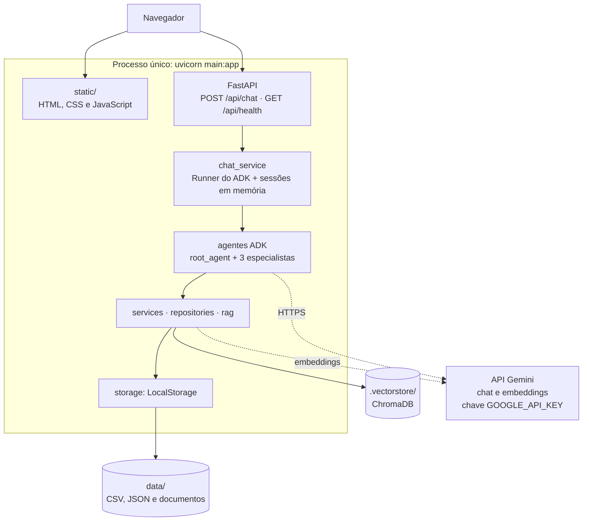
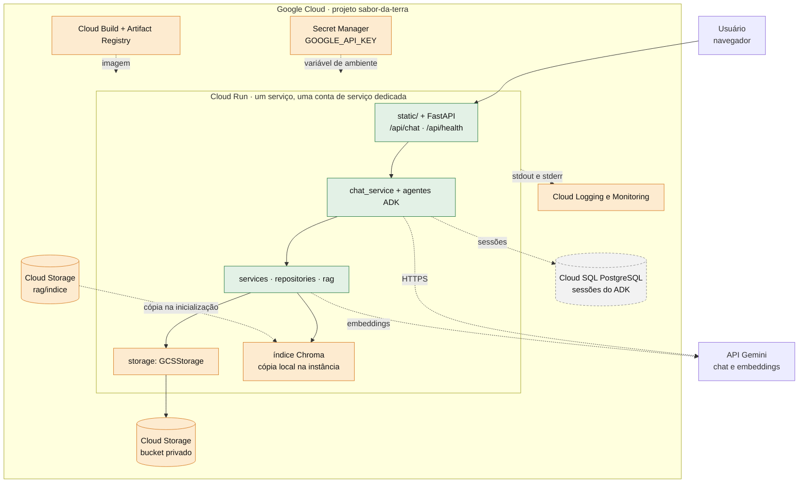
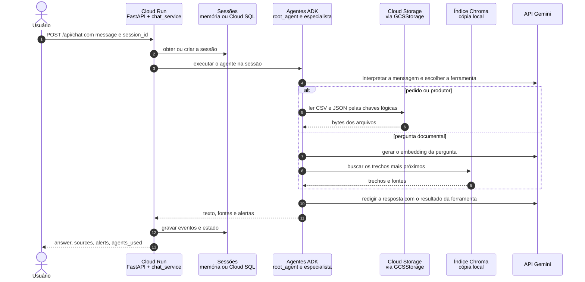
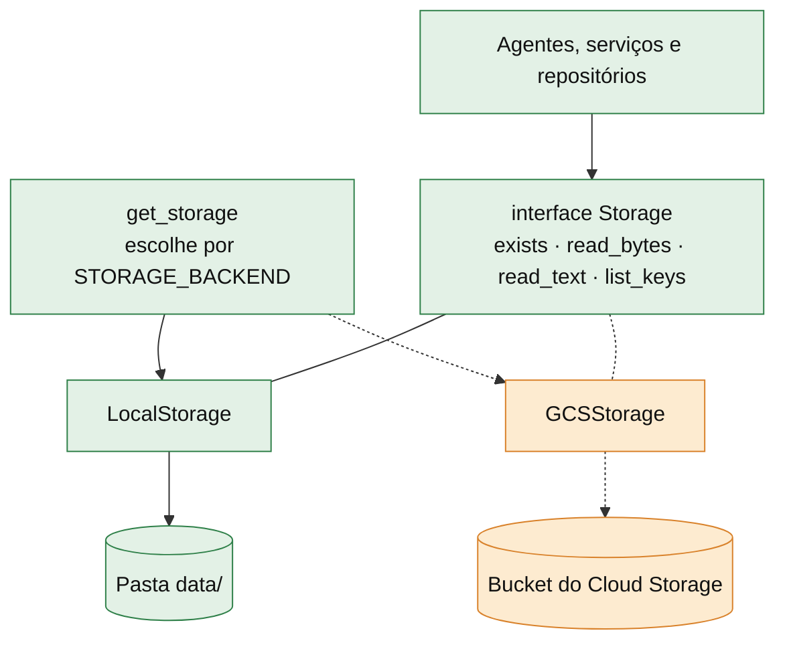
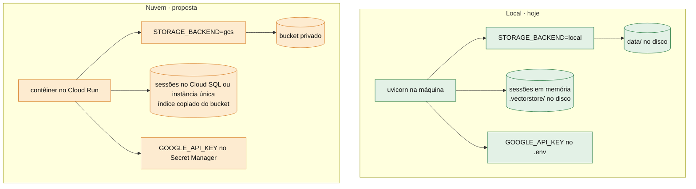
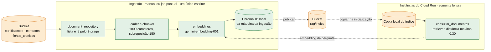
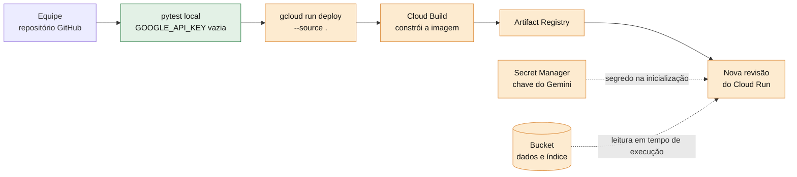

# Arquitetura no Google Cloud e plano de migração

Este documento é uma **proposta arquitetural**: explica como o Sabor da Terra sairia do computador local e passaria a funcionar no Google Cloud. **Nada aqui está implementado.** Nenhum recurso foi criado na nuvem, nenhum deploy foi feito e nenhum arquivo de código foi alterado para escrevê-lo. O que existe hoje no repositório está descrito em [`ARQUITETURA_E_DECISOES_TECNICAS.md`](ARQUITETURA_E_DECISOES_TECNICAS.md); aqui só se afirma sobre o código o que foi conferido em 19/11/2026.

Como ler as marcações:

| Marca | Significado |
|---|---|
| **Existe** | Conferido no código ou nos testes do repositório |
| **Decidido** | Decisão da equipe registrada nos documentos do projeto |
| **Proposto** | Recomendação deste documento, ainda sem implementação |
| **A validar** | Depende de teste, de consulta à documentação oficial ou de decisão da equipe |

Documentos relacionados: [`ESTRUTURA.md`](ESTRUTURA.md), [`ARQUITETURA_E_DECISOES_TECNICAS.md`](ARQUITETURA_E_DECISOES_TECNICAS.md) (seção 11 e decisão D5), [`CONTRATOS_ARQUITETURAIS.md`](CONTRATOS_ARQUITETURAIS.md), [`AGENTES_E_TRIAGEM.md`](AGENTES_E_TRIAGEM.md).

---

## 1. Resumo executivo

- O código já foi desenhado para a troca: agentes, serviços e repositórios pedem arquivos por **chave lógica** à interface `Storage`. Migrar para o Cloud Storage significa implementar **uma classe** (`GCSStorage`) e ligá-la por configuração, sem reescrever a aplicação.
- O backend FastAPI (que também serve o frontend) cabe em **um único serviço do Cloud Run**. O Cloud Storage guarda arquivos; **não hospeda** a aplicação Python nem substitui banco de dados.
- Três pontos exigem trabalho além do `GCSStorage`: **sessões** (hoje em memória, perdem-se quando o Cloud Run troca de instância), **índice vetorial** (ChromaDB em disco local, que no Cloud Run é temporário) e **autenticação** (hoje não há; o serviço não deve ficar aberto à internet sem decisão da equipe).
- A primeira versão em nuvem pode ser pequena: Cloud Run + bucket privado + Secret Manager + Cloud Logging (automático). Cloud SQL, Cloud Build contínuo e busca vetorial gerenciada são evoluções, com critérios para adotá-las na seção 5.
- **Prazo:** a Sauter desconsidera alterações na arquitetura entregue depois de 19/11/2026. A migração é uma evolução futura; para a demonstração de 20 e 21/11/2026 o armazenamento local continua sendo a opção segura.

## 2. Situação atual do projeto (conferida no código)

| Aspecto | Situação | Onde |
|---|---|---|
| Armazenamento de arquivos | `LocalStorage` lê a pasta `DATA_DIR` e bloqueia chaves que saiam da raiz (`../.env`) | `storage/local_storage.py` |
| Fábrica | `get_storage()` escolhe por `STORAGE_BACKEND`; `gcs` levanta `NotImplementedError` | `storage/__init__.py` |
| `GCSStorage` | **Esqueleto**: o construtor levanta `NotImplementedError` | `storage/gcs_storage.py` |
| Interface `Storage` | Apenas leitura: `exists`, `read_bytes`, `read_text`, `list_keys`. **Não há método de escrita** | `storage/base.py` |
| Quem usa `Storage` | `storage_repository` (CSV/JSON) e `document_repository` (documentos). Nada mais toca arquivos de dados | `repositories/` |
| Dados persistentes gravados pela aplicação | **Nenhum.** Pedidos triados e notificações não são gravados | decisão da equipe |
| Índice vetorial | `chromadb.PersistentClient` em `VECTOR_STORE_DIR` (`.vectorstore/`, fora do Git); coleção `sabor_da_terra`, distância cosseno | `rag/vector_store.py` |
| Embeddings | `gemini-embedding-001`, cliente `genai.Client(api_key=...)` com `GOOGLE_API_KEY` | `rag/vector_store.py` |
| Agentes | Google ADK 2.14.1; modelo `gemini-3.5-flash-lite` (`MODEL`); chave `GOOGLE_API_KEY` exportada para o ambiente | `agents/`, `services/chat_service.py` |
| Sessões | `InMemorySessionService`; `session_id` desconhecido gera sessão nova | `services/chat_service.py` |
| Autenticação | **Não há** | decisão da equipe |
| Frontend | Servido pelo próprio FastAPI (`StaticFiles`); chama `/api/chat` e `/api/health` por caminho relativo; **sem CORS configurado** | `main.py`, `static/js/app.js` |
| Logs | `logging.basicConfig` com texto simples no console | `utils/logger.py` |
| Contêiner | **Não há** `Dockerfile` nem `.dockerignore` | raiz |
| Extra do ADK para banco de sessões | `google-adk[db]` **não está instalado**: `DatabaseSessionService` falha com `ImportError` pedindo `pip install google-adk[db]` | verificado em 19/11/2026 |

Tamanho dos dados hoje: `data/` tem 31 arquivos e cerca de 148 KB; o índice vetorial real (20 documentos, 52 trechos) ocupa cerca de 2,6 MB.

### Variáveis de ambiente: planejadas × reais

O briefing desta proposta cita nomes planejados que **não são os do código**. O código manda; os nomes planejados servem de referência:

| Nome planejado | Nome real no código | Observação |
|---|---|---|
| `STORAGE_TYPE=local` / `gcs` | `STORAGE_BACKEND=local` / `gcs` | Já validado em `utils/config.py` |
| `DATA_DIR=./data` | `DATA_DIR=data` | Igual |
| `GCS_BUCKET_NAME` | `GCS_BUCKET` | Existe; `GCS_PREFIX` também existe |
| `RAG_DIR=./storage/chroma` | `VECTOR_STORE_DIR=.vectorstore` | Fora de `data/` e do Git |

## 3. Decisões arquiteturais já tomadas (**Decidido**)

1. A aplicação funciona localmente antes da nuvem, e o armazenamento local continua funcionando.
2. Trocar local por Cloud Storage não deve exigir reescrever serviços e repositórios (decisão D5).
3. O Cloud Storage guarda arquivos e documentos; o backend FastAPI será hospedado no Cloud Run.
4. O Cloud Storage não é servidor de aplicação nem banco transacional.
5. Camadas preservadas: API → chat_service → agentes → ferramentas → serviços → repositórios/RAG → storage.
6. Custos compatíveis com um projeto acadêmico; sem serviços gerenciados desnecessários.
7. A equipe confirmou em reunião (informado por David, 19/11/2026) a primeira versão sem persistência de pedidos e sem autenticação.

## 4. Arquitetura local (**Existe**)



Tudo roda em um processo e lê o disco da máquina. O único serviço externo é a API do Gemini.

## 5. Serviços Google Cloud avaliados

Classificação para a **primeira versão em nuvem**:

| Serviço | Classe | Papel no Sabor da Terra | Justificativa |
|---|---|---|---|
| **Cloud Storage** | Essencial | Guardar CSV, JSON e documentos da cooperativa | Decisão da equipe; substitui a pasta `data/` |
| **Cloud Run** | Essencial | Hospedar o FastAPI e o frontend estático em um contêiner | Decisão da equipe; escala conforme as requisições e pode reduzir a zero |
| **IAM e conta de serviço dedicada** | Essencial | Identidade do serviço com permissão só de leitura no bucket | Menor privilégio (capítulos 2 e 17 do e-book) |
| **Secret Manager** | Essencial | Guardar `GOOGLE_API_KEY` | Segredo não vai no código nem na imagem |
| **Cloud Logging** | Essencial (automático) | Receber o que a aplicação escreve em stdout/stderr | O Cloud Run captura sem agente; nada a instalar |
| **Artifact Registry e Cloud Build** | Essencial na prática | Construir e guardar a imagem | `gcloud run deploy --source .` usa os dois por baixo |
| **Cloud Monitoring** | Recomendado | Métricas de latência, erros e instâncias, alertas | Já vem com o Cloud Run; alertas exigem configuração |
| **Alerta de orçamento (Billing)** | Recomendado | Evitar surpresa de custo | Capítulo 1 do e-book |
| **Cloud SQL (PostgreSQL)** | Recomendado quando houver mais de uma instância ou uso contínuo | Persistir sessões do ADK | Sem isso, a conversa se perde na troca de instância (seção 9) |
| **Cloud Trace / OpenTelemetry** | Opcional | Ver o tempo de cada etapa (modelo, ferramenta) | Útil para diagnosticar lentidão; exige configuração (seção 12) |
| **Cloud Build com gatilho no GitHub** | Opcional | Publicar a cada merge | O deploy manual basta no começo |
| **Agent Runtime, Gemini Enterprise, Agent Gateway, Model Armor** | Desnecessário agora | Plataforma gerenciada de agentes e governança | O projeto já tem a API própria; custo e mudança de arquitetura não se justificam no prazo |
| **Vector Search (Agent Platform)** | Desnecessário agora | Busca vetorial gerenciada | O corpus tem 52 trechos (seção 9.3) |
| **BigQuery, Pub/Sub, Cloud Run functions** | Desnecessário | Análise em escala, mensageria, eventos | Nenhuma necessidade identificada no código |

### 5.1 Google Cloud Storage

O que ele faz bem para este projeto: guardar arquivos pequenos de forma durável, com acesso por IAM, sem administrar disco. O que **não** faz: executar Python, responder HTTP da aplicação, servir como banco com transações.

Recomendações (**Propostas**, com base no e-book, capítulo 3, e na documentação oficial):

- **Bucket privado** com *uniform bucket-level access* (só o IAM governa; ACLs desativadas) e *public access prevention* **forçado**. A documentação oficial informa que, com a prevenção forçada, nenhuma política IAM ou ACL consegue tornar o dado público, e que ela pode levar até 10 minutos para valer.
- **Região** igual à do Cloud Run (o e-book sugere `southamerica-east1`, por latência e LGPD). A escolha final é **A validar**: a disponibilidade do modelo Gemini e preços variam por região.
- **Classe Standard.** O volume é de centenas de KB e o acesso é frequente (cada pergunta pode ler arquivos); classes frias e regras de ciclo de vida não trazem ganho real neste tamanho.
- **Versionamento de objetos**: recomendado para os dados estruturados (`*.csv`, `*.json`), para recuperar uma versão anterior se alguém sobrescrever um arquivo por engano (e-book, questão 6). Opcional para o prazo atual.
- **Sem bucket público, sem URL assinada exposta ao navegador.** O navegador nunca acessa o bucket: só o backend, pela identidade do serviço.

### 5.2 Cloud Run

Fatos conferidos na documentação oficial (consulta de 19/11/2026):

- O contêiner precisa escutar em `0.0.0.0` na porta definida pela variável `PORT` (padrão 8080). Escutar só em `127.0.0.1` não funciona.
- O sistema de arquivos do contêiner é gravável, mas **fica em memória e some quando a instância para**; não há limite de tamanho configurável para ele, e escrever demais consome a memória da instância.
- O serviço escala automaticamente para o número de instâncias necessário; cada instância atende várias requisições ao mesmo tempo por padrão (configurável); sem tráfego, reduz ao mínimo de instâncias, que é zero por padrão.
- Tempo máximo de requisição: padrão de 300 s, máximo de 3600 s. O frontend desiste em 60 s, então o padrão basta.
- Serviços nascem **privados**: só quem tem permissão de invocação (papel *Cloud Run Invoker*) consegue chamar. Permitir invocação sem autenticação torna o serviço público.
- *Instâncias mínimas* evitam a demora da primeira requisição após inatividade, ao custo de manter uma instância ativa.

Por que o Cloud Run serve: o Sabor da Terra é uma API HTTP sem estado de disco obrigatório, com carga baixa e irregular. Por que o Cloud Storage não serve para isso: ele guarda objetos, não executa o `uvicorn`.

### 5.3 IAM e contas de serviço

- Uma **conta de serviço dedicada** (por exemplo `sabor-da-terra-run`), usada como identidade do serviço Cloud Run. Nunca a conta padrão do Compute Engine, que costuma ter o papel básico Editor (e-book, capítulo 17).
- Permissões mínimas: `roles/storage.objectViewer` **somente no bucket**; `roles/secretmanager.secretAccessor` **somente no segredo** da chave; `roles/cloudsql.client` se houver Cloud SQL. Escopo no recurso, não no projeto.
- Quem faz o deploy precisa de papéis próprios (Cloud Run, Cloud Build, uso da conta de serviço). Separar **desenvolvimento** (contas das pessoas, `gcloud auth application-default login`) de **produção** (conta de serviço do serviço).
- **Sem chave JSON** no repositório nem na imagem: no Cloud Run, a identidade do serviço é injetada pelo ambiente e a biblioteca do Cloud Storage a reconhece sozinha (credenciais padrão do ambiente).
- Projetos separados para desenvolvimento e produção, quando a equipe tiver os dois.

### 5.4 Secret Manager

Para o Sabor da Terra existe **um** segredo: `GOOGLE_API_KEY`. As demais variáveis (`STORAGE_BACKEND`, `GCS_BUCKET`, `GCS_PREFIX`, `APP_ENV`, `LOG_LEVEL`, `MODEL`, `VECTOR_STORE_DIR`) não são sensíveis e vão como variáveis de ambiente comuns. Segundo a documentação, o segredo pode chegar ao Cloud Run como variável de ambiente ou como arquivo montado; **como variável de ambiente ele é resolvido na inicialização da instância e o Google recomenda fixar uma versão numérica** em vez de `latest`. A conta de serviço precisa do papel *Secret Accessor* nesse segredo.

### 5.5 Cloud Logging, Monitoring e Trace

Ver a seção 12.

### 5.6 Cloud Build e integração contínua

`gcloud run deploy --source .` constrói a imagem no Cloud Build (a partir do `Dockerfile`, se houver), guarda no Artifact Registry e publica. A automação por gatilho no GitHub é **Opcional**; ver seção 14.

## 6. Arquitetura futura no Google Cloud (**Proposta**)

Legenda: caixas **verdes** já existem no código; **laranja** são propostas; **cinza tracejado** são opcionais.



Responsabilidade e comunicação de cada componente:

| Componente | Responsabilidade | Fala com | Dados que trafegam |
|---|---|---|---|
| Navegador | Interface de chat | Cloud Run (HTTPS, mesma origem) | `message`, `session_id`, `user_id` → `answer`, `sources`, `alerts` |
| Cloud Run | Rodar a API, os agentes e servir o frontend | Cloud Storage, Gemini, Secret Manager (na inicialização), Cloud SQL | Pedidos HTTP, arquivos lidos, prompts |
| Cloud Storage (`data`) | Fonte dos CSV, JSON e documentos | Só o Cloud Run | Bytes dos arquivos |
| Cloud Storage (`rag/indice`) | Distribuir o índice vetorial já construído | Cloud Run (leitura na inicialização) | Arquivos do ChromaDB |
| Secret Manager | Entregar a chave do Gemini | Cloud Run | Valor do segredo, uma vez por instância |
| Cloud SQL | Persistir sessões | Cloud Run | Eventos e estado das sessões |
| API Gemini | Interpretar mensagens e gerar embeddings | Cloud Run | Prompts, respostas, textos dos trechos e perguntas |
| Cloud Logging | Guardar logs | Recebe do Cloud Run | Linhas de log (sem conteúdo das mensagens) |

### 6.1 Fluxo de uma requisição (**Proposta**)

O fluxo dos agentes é o mesmo de hoje; muda **de onde vêm** os dados e as sessões.



## 7. Organização do bucket

### 7.1 Princípio: espelhar `data/`, não reorganizar

O código pede arquivos por **chave relativa à raiz de dados**: os CSV/JSON ficam na raiz (`produtores.csv`, `pedidos.json`, `financeiro.csv`…) e os documentos em `certificacoes/`, `contratos/` e `fichas_tecnicas/`; o `document_repository` usa o nome da pasta para definir o tipo do documento. Por isso a proposta **não adota** a estrutura ilustrativa do briefing (`documentos/originais`, `dados/produtos` etc.): ela exigiria mudar repositórios e o contrato de metadados do RAG. A estrutura proposta é o espelho de `data/` sob o prefixo `GCS_PREFIX`:

```text
gs://<bucket>/
└── <GCS_PREFIX>/                     # por exemplo "data/"
    ├── produtores.csv                # dados estruturados (raiz, como hoje)
    ├── financeiro.csv
    ├── lotes.csv
    ├── pedidos.json
    ├── sazonalidade.csv
    ├── tabela_precos_outubro_2026.csv
    ├── certificacoes/                # documentos para o RAG, por tipo
    ├── contratos/
    └── fichas_tecnicas/
└── rag/
    └── indice/                       # índice ChromaDB já construído (seção 9.3)
```

Por que cada separação: a raiz de dados é o que `LocalStorage` e `GCSStorage` precisam enxergar de forma idêntica; as três pastas de documentos carregam o tipo do documento; `rag/indice/` fica **fora** do prefixo de dados para que `list_keys` da ingestão nunca confunda arquivos do índice com documentos. Arquivos gerados pela aplicação (relatórios, notificações) **não existem hoje**; se a equipe decidir gravá-los no futuro, devem ir para um prefixo próprio (`gerados/`), com permissão de escrita só para a identidade que os grava.

Se a equipe preferir a estrutura do briefing, o custo é mudar os repositórios e o mapa de tipos de documento; fica como decisão **A validar**.

### 7.2 Perguntas operacionais

- **Como o backend localiza os arquivos:** `GCS_BUCKET` + `GCS_PREFIX` + chave lógica. `GCSStorage` junta prefixo e chave, e remove o prefixo ao listar, devolvendo as mesmas chaves que `LocalStorage` devolve.
- **Como os serviços leem:** não sabem que existe nuvem; chamam `get_storage().read_text(chave)`.
- **Como evitar acesso sem autorização:** o bucket é privado; o navegador nunca recebe URL do bucket; não há endpoint de listagem ou download de arquivos (os controllers de documentos são esqueleto e não estão registrados). O acesso a documentos só ocorre pela ferramenta `consultar_documentos`, dentro do agente. Quem pode falar com o agente é uma decisão de autenticação (seção 10).
- **Duplicação:** a ingestão é idempotente por documento (`replace_document`): reprocessar substitui os trechos. A identidade de um documento é a sua chave; o Cloud Storage guarda o hash de cada objeto como metadado, o que permite pular a reindexação quando o conteúdo não mudou (**Proposta**, não implementado).
- **Atualizações e versões:** com versionamento ligado, sobrescrever um objeto preserva a versão anterior. A cada mudança de documento, reexecutar a ingestão e republicar o índice (seção 9.3).
- **Falhas de leitura:** `GCSStorage` deve converter "objeto não existe" em `FileNotFoundError` (o contrato de `Storage`) e demais falhas de rede ou permissão em `OSError`, porque as ferramentas dos agentes já tratam `OSError` como erro controlado ("não foi possível consultar os dados agora"), sem derrubar o chat. A política de novas tentativas do cliente do Cloud Storage deve ser conferida na documentação da biblioteca (**A validar**).
- **Dados sensíveis:** os dados da cooperativa são fictícios, mas `produtores.csv` contém CPF e dados bancários. O código já os omite das respostas dos agentes; na nuvem, o bucket é privado e só a conta de serviço lê. Não copiar o conteúdo dos arquivos para logs.

## 8. Como a arquitetura atual migra sem reescrever a aplicação

### 8.1 A abstração existe



Conferido: `repositories/storage_repository.py` e `repositories/document_repository.py` recebem um `Storage` (ou chamam `get_storage()`); nenhum outro módulo lê arquivos de dados. Por isso a troca fica confinada a `storage/`.

Comparação entre os dois ambientes (**verde** existe; **laranja** proposto):



O que não muda entre os dois: a interface `Storage`, os repositórios, os serviços, os agentes e os testes.

### 8.2 Ajustes necessários (**Proposto**; nada feito)

| Arquivo | Mudança | Motivo |
|---|---|---|
| `storage/gcs_storage.py` | Implementar `exists`, `read_bytes`, `read_text`, `list_keys` com `google-cloud-storage` | Hoje é esqueleto |
| `storage/__init__.py` | Instanciar `GCSStorage(GCS_BUCKET, GCS_PREFIX)` quando `STORAGE_BACKEND=gcs`; recusar `gcs` sem `GCS_BUCKET` com mensagem clara | Hoje levanta `NotImplementedError` |
| `utils/config.py` | Possíveis variáveis novas: URL do banco de sessões e local do índice publicado | Sessões e índice (seção 9) |
| `services/chat_service.py` | Aceitar um serviço de sessão persistente por configuração, mantendo `InMemorySessionService` como padrão local | Sessões (seção 9.2) |
| `rag/vector_store.py` | Opcionalmente, baixar o índice do bucket na inicialização | Índice (seção 9.3) |
| `pyproject.toml` | Acrescentar o extra `db` (`google-adk[db]` e driver PostgreSQL) se houver Cloud SQL; o extra `gcs` **já existe** | `DatabaseSessionService` exige SQLAlchemy |
| `Dockerfile` e `.dockerignore` (novos) | Imagem Python 3.12 que sobe `uvicorn main:app --host 0.0.0.0 --port $PORT`, sem `.env`, `.venv` nem `.vectorstore` | Cloud Run (seção 11) |
| `.env.example` | Documentar as variáveis novas (sem valores secretos) | Configuração |
| `storage/base.py` | **Só se** a equipe decidir gravar arquivos: acrescentar métodos de escrita | Hoje a interface é somente leitura |

### 8.3 Sem espalhar chamadas do Google Cloud

Toda chamada ao `google-cloud-storage` fica dentro de `GCSStorage`; o import da biblioteca deve ser tardio (como o import do ADK em `chat_service`), para que o servidor local suba sem o extra `gcs`.

### 8.4 Evitar diferenças entre `LocalStorage` e `GCSStorage`

Os comportamentos que os dois precisam compartilhar (conferidos em `LocalStorage`):

- `list_keys` devolve chaves **ordenadas**, com `/`, relativas à raiz, **sem diretórios** e **ignorando** `.gitkeep` e `.DS_Store`.
- Chave que saia da raiz (`../x`) levanta `ValueError`. Um objeto do bucket pode ter `..` no nome; `GCSStorage` deve rejeitar chaves com `..` ou começando com `/` da mesma forma.
- `read_*` de arquivo inexistente levanta `FileNotFoundError`; `read_text` decodifica com `utf-8` por padrão.
- Os CSV são lidos com `utf-8-sig` pelos repositórios; isso independe do backend.

### 8.5 Testes

- **Sem nuvem (padrão):** um teste de contrato parametrizado roda os mesmos cenários contra `LocalStorage` (pasta temporária) e contra `GCSStorage` com um **cliente falso** (objeto que imita blobs em memória). Assim a suíte continua rodando com `GOOGLE_API_KEY` vazia e sem rede.
- **Integração controlada:** testes marcados e ignorados por padrão, executados só com um bucket de teste dedicado e variável explícita (como `RUN_RETRIEVER_QUALITY=1` já faz para o retriever). Nunca contra o bucket de produção.
- Os repositórios e serviços já são testados com `LocalStorage`; não precisam de teste novo por causa da troca.

## 9. Sessões, RAG e persistência na nuvem

| Tipo de dado | Onde fica na nuvem | Situação |
|---|---|---|
| Documentos e arquivos de dados | Cloud Storage | **Proposto** (seções 5.1 e 7) |
| Sessões e histórico do ADK | Cloud SQL (PostgreSQL) via `DatabaseSessionService`, ou instância única | **A validar** (9.2) |
| Índice vetorial | Cópia local na instância, publicada no Cloud Storage | **Proposto** (9.3) |
| Dados transacionais (pedidos, notificações) | **Não existem**; a equipe decidiu não gravar | **Decidido** |
| Logs e métricas | Cloud Logging e Cloud Monitoring | **Proposto** (seção 12) |

### 9.1 Por que não usar memória nem disco do Cloud Run para o que precisa sobreviver

O disco do contêiner é memória que some quando a instância para, e o Cloud Run cria e destrói instâncias conforme a carga, com várias em paralelo. Sessões em memória deixam a conversa de um usuário "sumir" se a próxima requisição cair em outra instância ou depois de uma reciclagem (o e-book, capítulos 16 e 19, e a documentação do ADK avisam exatamente isso). O Cloud Storage **não** é a solução: é armazenamento de objetos, sem transações e sem consulta, e a montagem do bucket como pasta (Cloud Storage FUSE) tem limitações documentadas: sem bloqueio de arquivos para escritas concorrentes ("a última escrita vence"), não é totalmente compatível com POSIX e pode atrasar ou impedir a inicialização.

### 9.2 Sessões

Hoje: `InMemorySessionService`, perda ao reiniciar; `session_id` desconhecido vira sessão nova (**Existe**). Opções, da mais simples à mais robusta:

| Opção | Como | Vantagens | Limitações |
|---|---|---|---|
| A. Manter em memória com **uma única instância** (máximo e mínimo de instâncias = 1) | Configuração do Cloud Run | Zero mudança de código, zero custo extra | Reiniciar ou reimplantar apaga as conversas; uma instância limita a capacidade; é uma restrição **artificial**, não uma solução |
| B. **Cloud SQL (PostgreSQL)** + `DatabaseSessionService` | Instância pequena, conexão pelo soquete `/cloudsql/...`, `chat_service` recebe a URL | Sessões sobrevivem a reinícios e a várias instâncias; é o caminho que o e-book descreve para o Cloud Run | Há **custo contínuo** enquanto a instância existir; exige o extra `db`, mudança em `chat_service`, conta com o papel *Cloud SQL Client*; limite de conexões por instância do Cloud Run exige pool pequeno |
| C. Agent Platform Sessions (`VertexAiSessionService`) | Serviço gerenciado do Agent Platform | Sem banco para administrar | Exige o ecossistema do Agent Runtime (identificador de agente), que muda a arquitetura; **não recomendado agora** |

Recomendação: **A para a demonstração e o piloto**, **B quando houver uso contínuo ou mais de uma instância**. O estado que a aplicação guarda na sessão (`fontes_documentais`, `alertas_pedido`) são listas de dicionários simples, compatíveis com serialização em banco; isso deve ser **validado em teste** ao implementar a opção B. A documentação do Cloud SQL para o Cloud Run observa ainda que, com cobrança por requisição, a CPU reduzida em repouso pode atrapalhar a manutenção do pool de conexões; a cobrança por instância evita isso (**A validar**).

### 9.3 RAG e índice vetorial

Hoje o `PersistentClient` do ChromaDB grava em `.vectorstore/` (**Existe**). No Cloud Run, essa pasta é temporária. Pontos conferidos:

- A documentação do Chroma descreve a implantação como de **nó único**, com o índice HNSW em RAM e o resto em disco (SQLite). Para o nosso corpus (52 trechos, 2,6 MB) a carga é desprezível; deployments com menos de 2 GB de RAM não são recomendados pela documentação do Chroma para cargas maiores, por isso a memória da instância deve ser **validada com teste**, não presumida.
- Na consulta, cada pergunta chama a API de embeddings (`RETRIEVAL_QUERY`); então **a instância precisa do acesso ao Gemini também para o RAG**, não só para os agentes.
- Várias instâncias, cada uma com sua cópia **somente leitura** do índice, funcionam bem para consultas. O problema é **escrever**: duas instâncias reindexando ao mesmo tempo, ou o Chroma sobre o bucket montado como pasta (sem bloqueio de arquivos), corrompem ou perdem dados. Por isso a **ingestão não deve rodar dentro das instâncias do serviço**.

Estratégias para entregar o índice à instância:

| Estratégia | Como | Vantagens | Limitações |
|---|---|---|---|
| 1. Construir na inicialização | Cada instância roda a ingestão ao subir | Simples; sem artefato extra | Cerca de 20 s e chamadas à API de embeddings **por instância e por inicialização**; consome cota e deixa a primeira requisição lenta |
| 2. **Publicar o índice no bucket** e copiar na inicialização | A ingestão roda **uma vez** (máquina da equipe ou job), o resultado vai para `rag/indice/`, e cada instância baixa para uma pasta local | Inicialização rápida; sem gastar embeddings por instância; um único escritor | Passo de publicação a cada mudança de documentos; é preciso garantir que o índice combine com os documentos |
| 3. Assar o índice na imagem | A ingestão roda no build | Nenhuma cópia em runtime | Build precisa da chave e do acesso ao bucket; imagem nova a cada mudança de documentos |

Recomendação (**Proposta**): **estratégia 2**, com a ingestão executada manualmente (ou por um job pontual) quando os documentos mudarem. A estratégia 1 serve de contingência.

Fluxo de ingestão e consulta documental com Cloud Storage (**Proposta**; na ingestão local de hoje, só a origem dos arquivos e o destino do índice mudam):



**Vector Search gerenciado e outras alternativas:** a documentação oficial descreve o Vector Search (ScaNN) como serviço pago, pensado para conjuntos grandes, que exige implantar um índice em um *endpoint* para consultar, com custo pelas máquinas que hospedam o índice. Com 52 trechos, **não há necessidade real**; reavaliar apenas se o corpus crescer ordens de grandeza ou se houver necessidade de várias instâncias gravando. O e-book também cita o AlloyDB com busca vetorial, que só compensaria se o projeto adotasse PostgreSQL por outro motivo. Não se recomenda migrar agora.

## 10. Segurança e governança

Baseado no capítulo 17 do e-book e no código existente:

| Medida | Protótipo acadêmico | Produção |
|---|---|---|
| Bucket privado, acesso uniforme, prevenção de acesso público | **Obrigatório** | Obrigatório |
| Conta de serviço dedicada, menor privilégio, sem chave JSON | **Obrigatório** | Obrigatório |
| `GOOGLE_API_KEY` no Secret Manager, versão fixada | **Obrigatório** | Obrigatório |
| Controle de quem acessa o serviço | **Decisão pendente.** Serviço público expõe os dados da cooperativa | Autenticação de usuários; as recusas de consulta de valores pessoais continuam sendo só salvaguarda de prompt |
| Controle de acesso por usuário e operação | Não existe; não há dados pessoais reais | Escopo por usuário vindo da autenticação, nunca de argumento que o modelo preenche |
| Validação de arquivos enviados | Não se aplica: **não há upload** | Se houver: tipo, tamanho, conteúdo, área de quarentena e permissão de escrita separada |
| Documentos como conteúdo não confiável (injeção de prompt no RAG) | **Existe**: as ferramentas orientam o modelo a tratar o trecho como dado, nunca instrução | Acrescentar filtro de entrada e saída (por exemplo Model Armor) conforme a sensibilidade |
| Limites de chamadas e iterações dos agentes | O Free Tier já limita; o chat responde 429 amigável | Cotas explícitas, limite de instâncias, alertas de orçamento |
| Confirmação em operações críticas | Não se aplica: nenhum agente grava ou envia | `require_confirmation` em qualquer ferramenta com efeito externo |
| Auditoria | Logs do Cloud Run e do IAM | Logs de auditoria de acesso a dados do Cloud Storage habilitados |
| Logs sem dados sensíveis | **Existe**: `chat_service` não registra o conteúdo das mensagens | Revisar também os logs do Cloud SQL e do Cloud Storage |

**Quem pode chamar o serviço (decisão pendente):** serviços do Cloud Run nascem privados; o navegador não envia o token de invocação sozinho, então um frontend público exige uma de três escolhas: (a) permitir invocação sem autenticação **apenas durante a demonstração**, sabendo que isso expõe os dados; (b) colocar uma camada de identidade na frente (opções como o Identity-Aware Proxy ou autenticação própria; **A validar** na documentação oficial, pois não foi conferida aqui); (c) manter a demonstração no computador local. Esta decisão cabe ao Murilo e à equipe.

**Chave do Gemini e privacidade:** o e-book avisa que, no nível gratuito da API do AI Studio, o Google pode usar o conteúdo enviado para melhorar seus produtos, e recomenda o Agent Platform para dados de empresa. Os dados atuais são fictícios; para dados reais, a opção de usar credenciais do projeto (seção 11.3) deve ser reavaliada.

## 11. Deploy no Cloud Run

### 11.1 Contêiner (**Proposto**)

- Base Python 3.12 (a versão exigida pelo projeto), instalando `.[ai,rag,gcs]` e, se houver Cloud SQL, `db`.
- Comando: `uvicorn main:app --host 0.0.0.0 --port $PORT`. O padrão do Cloud Run é 8080; o `adk deploy` usa 8000 por padrão, mas esta aplicação não usa o servidor do ADK, e sim o próprio `main.py`.
- Executar como usuário sem privilégios; o `.dockerignore` deve excluir `.env`, `.venv`, `.vectorstore`, `.git` e `tests`.
- O frontend vai **dentro do mesmo serviço** (como hoje, `StaticFiles`), de modo que o navegador e a API têm a mesma origem: os caminhos relativos `/api/chat` e `/api/health` continuam funcionando e **não é preciso configurar CORS**. Hospedar o frontend à parte no Cloud Storage obrigaria a configurar CORS e a trocar os caminhos relativos; não vale a pena nesta fase.

### 11.2 Configuração do serviço

| Item | Proposta | Observação |
|---|---|---|
| Região | `southamerica-east1` (e-book) | **A validar**: preço e disponibilidade do modelo por região |
| Variáveis comuns | `APP_ENV=production`, `LOG_LEVEL`, `MODEL`, `STORAGE_BACKEND=gcs`, `GCS_BUCKET`, `GCS_PREFIX`, `VECTOR_STORE_DIR` (pasta local de cópia do índice) | Sem valores secretos |
| Segredo | `GOOGLE_API_KEY` do Secret Manager, versão fixada | Seção 5.4 |
| Conta de serviço | Dedicada, com os papéis da seção 5.3 | |
| Acesso | **Privado por padrão**; abrir só por decisão (seção 10) | |
| Instâncias | Mínimo 0 (custo zero em repouso) ou 1 (sem demora na primeira requisição); máximo baixo, para limitar custo e a cota do Gemini | O gargalo real é a cota do Gemini, não o Cloud Run |
| Memória e CPU | Começar pequeno e **medir**; subir se houver reinícios por falta de memória | O disco em memória também consome a memória da instância |
| Concorrência | Manter o padrão e testar com carga realista | **A validar**: não foi medida |
| Tempo limite | Padrão (300 s) | O frontend desiste em 60 s |

### 11.3 Como os agentes usam o Gemini na nuvem

Hoje, agentes e embeddings usam **chave de API** (`GOOGLE_API_KEY`), e o `chat_service` recusa subir a IA sem ela (**Existe**). Duas opções:

1. **Manter a chave de API no Secret Manager** (**Proposta para a primeira versão**): nenhuma mudança de código; vale a cota e a política de dados do nível usado pela chave (o Free Tier tem limite baixo, observado em torno de 15 requisições por minuto).
2. **Credenciais do próprio projeto no Agent Platform** (variáveis `GOOGLE_GENAI_USE_ENTERPRISE`, `GOOGLE_CLOUD_PROJECT`, `GOOGLE_CLOUD_LOCATION`, descritas no e-book e na documentação do ADK, e papel `roles/aiplatform.user` para a conta de serviço): elimina a chave, mas **exige mudar** `chat_service.py` e `rag/vector_store.py` (ambos dependem de `GOOGLE_API_KEY`) e **conferir se `gemini-3.5-flash-lite` e `gemini-embedding-001` estão disponíveis na região escolhida** (**A validar**; o e-book manda consultar o catálogo e avisa que modelos têm data de aposentadoria).

### 11.4 Fluxo de publicação



`gcloud run deploy --source .` constrói no Cloud Build usando o `Dockerfile`, guarda a imagem no Artifact Registry (repositório criado automaticamente na região) e cria uma nova revisão. Exige as APIs do Cloud Run e do Cloud Build habilitadas e papéis específicos para quem faz o deploy. Cada revisão nova mantém as anteriores, o que permite voltar atrás.

## 12. Observabilidade

- **Logs (essencial, automático):** o Cloud Run coleta o que a aplicação escreve em stdout e stderr, sem agente. Hoje o `utils/logger.py` escreve texto simples; ele chegará como texto (`textPayload`). Para ter **severidade e campos filtráveis** seria preciso escrever JSON de uma linha (campos `severity` e `message`); é uma melhoria futura e pequena (**Proposta**).
- **O que olhar:** no Logs Explorer, filtrar por `resource.type="cloud_run_revision"` e o nome do serviço (exemplo do e-book, capítulo 4). Os logs de `chat_service` já registram a sessão (prefixo), os agentes acionados, o número de fontes e o **tipo** das exceções, nunca o conteúdo.
- **Métricas e alertas:** o Cloud Monitoring traz latência, contagem de requisições, erros e instâncias do Cloud Run; alertas para taxa de erro 5xx e latência são **Recomendados**.
- **Falhas de integração:** os erros do Gemini já viram status distintos (429 limite, 503 IA indisponível ou chave recusada, 502 falha); esses códigos aparecem nas métricas de requisição e servem de alerta.
- **Trace e OpenTelemetry (opcional):** o ADK é instrumentado com OpenTelemetry e as bibliotecas estão instaladas como dependência. O e-book descreve a opção `--otel_to_cloud` do `adk deploy` e do `adk web`; como o Sabor da Terra **não usa** o servidor do ADK (usa `main.py`), a exportação para o Cloud Trace teria de ser configurada à mão. **A validar** na documentação do ADK antes de prometer.
- **Custos:** alerta de orçamento no Billing; acompanhar o consumo de tokens pelo painel da própria API do Gemini.

## 13. Estimativa e controle de custos

**Não há valores neste documento.** Os preços do Google Cloud variam por região, classe e uso, e as páginas oficiais de preço não puderam ser lidas de forma confiável na consulta de 19/11/2026 (a página carrega o conteúdo dinamicamente). Qualquer número deve vir da **calculadora oficial** (cloud.google.com/products/calculator) com as premissas abaixo, anotando a data.

Premissas de volume (do código atual, para alimentar a calculadora):

- Cloud Storage: cerca de 150 KB de dados e documentos, mais uma cópia do índice de cerca de 2,6 MB; poucas centenas de leituras por dia.
- Cloud Run: dezenas a centenas de requisições por dia, cada uma de 5 a 20 segundos (a maior parte é espera pelo Gemini); uma instância ativa por vez.
- IA: cada mensagem faz de 3 a 6 chamadas ao modelo; mais uma chamada de embedding por pergunta documental.

| Fator de custo | O que o provoca neste projeto | Como controlar |
|---|---|---|
| Armazenamento (Cloud Storage) | Volume mínimo; versionamento acumula versões | Versionamento só nos dados estruturados; remover versões antigas |
| Operações de leitura e escrita | Cada leitura de arquivo é uma operação | Ler uma vez e guardar em memória, se os arquivos forem relidos a cada pergunta (**A validar**: hoje `LocalStorage` relê do disco) |
| Tráfego de saída | Respostas ao navegador; chamadas à API do Gemini | Região única para bucket e serviço |
| Cloud Run | Tempo de CPU e memória enquanto atende requisições; instância mínima ligada gera custo contínuo | Mínimo 0; máximo baixo; a camada gratuita mensal existe (o e-book cita 2 milhões de requisições por mês no nível gratuito; **conferir os valores atuais e as regiões elegíveis** na página oficial) |
| Cloud SQL | Instância ligada o tempo todo, mesmo sem uso | Só criar quando houver necessidade (seção 9.2); apagar o que não usar |
| IA (tokens) | Cada mensagem; prompts longos de instruções e ferramentas | Modelo menor (Flash-Lite, já em uso); espaçar chamadas; acompanhar a cota |
| Observabilidade | Volume de logs além da cota gratuita | Não registrar conteúdo; excluir logs de requisição desnecessários |

**Configuração inicial econômica (Proposta):** Cloud Run com mínimo 0 e máximo baixo, sessões em memória com uma instância, bucket Standard privado, segredo no Secret Manager, alerta de orçamento. **Quando aumentar:** passar a mínimo 1 se a primeira resposta lenta incomodar; criar o Cloud SQL quando houver uso contínuo ou várias instâncias; revisar a busca vetorial só se o corpus crescer muito.

## 14. Plano de migração por etapas

Planejamento apenas; **nenhuma etapa foi executada**.

| Etapa | Objetivo | Serviços | Mudanças no projeto | Dependências | Riscos | Concluída quando |
|---|---|---|---|---|---|---|
| **1. Aplicação local** | Manter o que funciona; fechar pendências de abstração | — | Nenhuma além de confirmar que só `storage/` toca arquivos de dados (já conferido) | Entrega de 19/11 | — | `pytest` e `node qa/test_logica.js` passam; demonstração local ensaiada |
| **2. Preparação** | Deixar o código pronto para a nuvem | — | Teste de contrato de `Storage`; variáveis novas no `.env.example`; import tardio de `google-cloud-storage` | Decisão sobre sessões e autenticação | Mudar mais do que o necessário | Suíte verde sem nuvem; nenhum comportamento local alterado |
| **3. Cloud Storage** | Dados lidos do bucket | Cloud Storage, IAM | Implementar `GCSStorage` e `get_storage()`; criar bucket privado com acesso uniforme e prevenção de acesso público; subir `data/` | Projeto e faturamento no Google Cloud; permissões | Diferença de comportamento entre backends; chave `..` em objetos | Os testes de contrato passam nos dois backends; o app local com `STORAGE_BACKEND=gcs` lê dados e documentos do bucket de teste |
| **4. Cloud Run** | Backend e frontend no ar | Cloud Run, Cloud Build, Artifact Registry, Secret Manager | `Dockerfile`, `.dockerignore`; segredo da chave; conta de serviço dedicada | Etapa 3; APIs habilitadas | Chave exposta; imagem com `.env`; serviço aberto demais | `/api/health` responde; uma pergunta de pedido e uma de documento funcionam na URL do serviço |
| **5. Persistência** | Sessões e índice | Cloud SQL (se necessário), Cloud Storage | Extra `db`; `chat_service` com sessão persistente; publicação e cópia do índice | Etapa 4; decisão sobre Cloud SQL | Custo contínuo do banco; índice desatualizado | A conversa continua após reiniciar o serviço; consultas documentais funcionam sem reconstruir o índice na inicialização |
| **6. Segurança e observabilidade** | Proteger e enxergar | IAM, Secret Manager, Logging, Monitoring, Billing | Revisar papéis; alertas de erro, latência e orçamento; decidir acesso ao serviço | Etapa 4 | Alertas ruidosos | Checklist da seção 10 cumprido para o nível escolhido |
| **7. Validação** | Provar que funciona | Todos | Testes de integração com bucket de teste; roteiro da demonstração na nuvem | Etapas anteriores | Gastar cota do Gemini nos testes | Roteiro de `ROTEIRO_DEMONSTRACAO.md` executado na nuvem sem erros |
| **8. Operação** | Manter | Logging, Monitoring, Billing | Documentar como publicar atualizações, reindexar e revisar custos | Etapa 7 | Conhecimento concentrado em uma pessoa | Procedimentos escritos e testados por outra pessoa da equipe |

## 15. Riscos, limitações e decisões pendentes

**Riscos e limitações**

- A interface `Storage` é somente leitura: qualquer gravação futura exige estendê-la.
- `GCSStorage`, `Dockerfile`, sessões persistentes e distribuição do índice **não existem**.
- Sessões em memória perdem o contexto ao trocar de instância (seção 9.1).
- O Free Tier do Gemini tem limite baixo de requisições por minuto; vale também na nuvem.
- Sem autenticação, publicar o serviço o expõe (seção 10).
- Preços não foram consultados; a decisão de região depende de verificar disponibilidade de modelos.
- O e-book foi escrito para o ADK 2.12 e o modelo `gemini-3.5-flash`; o projeto usa o ADK 2.14.1 e `gemini-3.5-flash-lite`. Comandos e identificadores do e-book **não foram tratados como automaticamente atuais**.

**Decisões pendentes (da equipe)**

| Decisão | Sugestão deste documento | Quem decide |
|---|---|---|
| Migrar antes ou depois das apresentações | Depois: manter o local na demonstração | Equipe |
| Quem pode chamar o serviço | Privado por padrão; abertura só temporária, por decisão explícita | Murilo e equipe |
| Sessões: memória com instância única ou Cloud SQL | A para demonstração; B para uso contínuo | David, Murilo |
| Chave de API ou credenciais do projeto | Chave no Secret Manager na primeira versão | David |
| Região | `southamerica-east1`, após conferir modelos | Equipe |
| Estrutura do bucket | Espelho de `data/` | Arthur, Rawan |
| Entrega do índice | Publicar no bucket (estratégia 2) | Rawan |
| Gravar arquivos gerados pela aplicação | Não, até haver decisão sobre persistência de pedidos | Equipe |

## 16. Referências

Material de estudo (referência principal):

- SAUTER. *Desenvolvimento de agentes no Ecossistema Google*, e-book, outubro de 2026: capítulos 1 a 4 (nuvem, IAM, armazenamento, Cloud Run, logs), 9 e 10 (ferramentas, sessões), 15 a 17 (avaliação, deploy, segurança).

Documentação oficial consultada em 19/11/2026:

- Contrato do contêiner do Cloud Run: <https://docs.cloud.google.com/run/docs/reference/container-contract>
- Segredos no Cloud Run: <https://docs.cloud.google.com/run/docs/configuring/services/secrets>
- Autenticação no Cloud Run: <https://docs.cloud.google.com/run/docs/authenticating/overview>
- Tempo limite de requisição: <https://docs.cloud.google.com/run/docs/configuring/request-timeout>
- Instâncias mínimas: <https://docs.cloud.google.com/run/docs/configuring/min-instances>
- Logs do Cloud Run: <https://docs.cloud.google.com/run/docs/logging>
- Deploy a partir do código-fonte: <https://docs.cloud.google.com/run/docs/deploying-source-code>
- Cloud Storage montado como volume no Cloud Run: <https://docs.cloud.google.com/run/docs/configuring/services/cloud-storage-volume-mounts>
- Acesso uniforme no nível do bucket: <https://docs.cloud.google.com/storage/docs/uniform-bucket-level-access>
- Prevenção de acesso público: <https://docs.cloud.google.com/storage/docs/public-access-prevention>
- Cloud SQL a partir do Cloud Run: <https://docs.cloud.google.com/sql/docs/postgres/connect-run>
- Deploy do ADK no Cloud Run: <https://adk.dev/deploy/cloud-run/>
- Desempenho e implantação do Chroma: <https://docs.trychroma.com/guides/deploy/performance>
- Vector Search: <https://docs.cloud.google.com/vertex-ai/docs/vector-search/overview>

**Não conferido nesta consulta:** páginas de preço (Cloud Run e Cloud Storage), Identity-Aware Proxy, disponibilidade de `gemini-3.5-flash-lite` e `gemini-embedding-001` no Agent Platform por região, exportação de traces do ADK fora do `adk deploy`.

## 17. Explicação para a equipe: do computador à nuvem, com um exemplo

Imagine que a Dona Lúcia, da equipe da cooperativa, abre o Sabor da Terra e escreve: *"O Restaurante Raízes quer 30 kg de queijo coalho para o dia 25/11"*.

**Hoje, no computador do David:** o navegador fala com o `uvicorn` da mesma máquina. O agente de pedidos chama a ferramenta de triagem, que lê `produtores.csv` e `sazonalidade.csv` da pasta `data/` e chama a API do Gemini com a chave do `.env`. Se a pergunta fosse sobre o contrato do Raízes, o agente de documentos consultaria o índice vetorial na pasta `.vectorstore/`. A conversa fica na memória do processo.

**Na nuvem, o que mudaria:**

1. **Onde cada parte fica.** O mesmo programa (API, agentes e a página) fica empacotado em um contêiner e roda no **Cloud Run**, em uma URL própria. Os arquivos `produtores.csv`, `pedidos.json` e os documentos ficam em um **bucket privado do Cloud Storage**, na mesma organização de pastas de `data/`.
2. **Como o navegador acha o backend.** Não acha nada novo: a página é servida pelo mesmo serviço, então `/api/chat` continua sendo um caminho relativo na mesma origem.
3. **Como o backend lê o bucket.** Quando `STORAGE_BACKEND=gcs`, a fábrica `get_storage()` entrega o `GCSStorage` no lugar do `LocalStorage`. A ferramenta de triagem continua pedindo `produtores.csv` ao repositório, que continua pedindo à interface `Storage`; só o "de onde vem o arquivo" mudou. O serviço usa a **conta de serviço** do Cloud Run, com permissão só de leitura nesse bucket: não existe senha nem arquivo de chave.
4. **Como os agentes usam o Gemini.** Do mesmo jeito, com a chave guardada no **Secret Manager** e entregue como variável de ambiente à instância.
5. **Como o RAG consulta os documentos.** O índice do ChromaDB é construído **uma vez** pela equipe e publicado no bucket (`rag/indice/`); cada instância copia esse índice para uma pasta local ao subir. A pergunta da Dona Lúcia sobre o contrato é transformada em embedding pelo Gemini e comparada com o índice local.
6. **Onde ficam as sessões.** Se o Cloud Run criar uma segunda instância, a conversa da Dona Lúcia poderia cair nela e "sumir". Para a demonstração, limita-se a **uma instância**; para uso real, as sessões vão para um **Cloud SQL (PostgreSQL)**, e qualquer instância as encontra.
7. **Como a equipe publica atualizações.** Roda os testes localmente e executa `gcloud run deploy --source .`: o Google constrói a imagem, guarda no Artifact Registry e cria uma nova revisão; se algo der errado, volta-se à revisão anterior.
8. **Como monitora erros e custos.** O que o programa escreve no console vai para o **Cloud Logging** sem instalar nada; o **Cloud Monitoring** mostra erros e latência; um **alerta de orçamento** avisa se o gasto passar do limite. Os códigos 429, 503 e 502 do chat indicam, respectivamente, limite do Gemini, IA indisponível e falha do assistente.

O que **não** muda: as camadas, os contratos, os agentes, os prompts e os testes. O que **precisa ser construído**: o `GCSStorage`, o `Dockerfile`, a escolha e implementação de sessões persistentes, o passo de publicação do índice e uma decisão sobre quem pode acessar o serviço.
