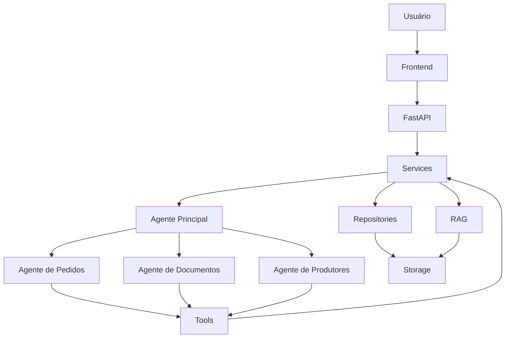

# Contratos Arquiteturais — Sabor da Terra

Este documento define os contratos de comunicação e integração entre as camadas e os componentes do projeto Sabor da Terra. Seu objetivo é estabelecer interfaces comuns para o desenvolvimento independente dos módulos, reduzir inconsistências e facilitar a integração das entregas.

Os contratos aqui descritos representam a proposta inicial de integração e devem ser alinhados com os respectivos responsáveis antes de serem considerados definitivos.

---

## 1. Objetivos

Estabelecer padrões para:

- Comunicação entre o agente principal e os agentes especializados.
- Comunicação entre agentes, ferramentas e serviços.
- Comunicação entre serviços, repositórios e modelos.
- Integração entre o módulo RAG e o agente de Documentos.
- Comunicação HTTP entre frontend e backend.
- Padronização de respostas, erros, fontes e sessões.
- Definição das responsabilidades de cada camada.

## 2. Visão geral da arquitetura

A aplicação segue uma arquitetura em camadas, na qual cada componente possui responsabilidades específicas.



### 2.1. Responsabilidades das camadas

| Camada | Responsabilidade |
|---|---|
| API | Receber requisições HTTP, validar entradas e retornar respostas. |
| Services | Executar regras de negócio e coordenar operações. |
| Agents | Interpretar solicitações e decidir quais ferramentas utilizar. |
| Tools | Disponibilizar operações controladas aos agentes. |
| Repositories | Consultar e manipular dados estruturados. |
| RAG | Recuperar informações relevantes dos documentos. |
| Storage | Abstrair o acesso aos arquivos e ao armazenamento. |
| Models | Definir contratos e estruturas de dados com Pydantic. |

**Princípio arquitetural:** os agentes interpretam as solicitações e coordenam operações, enquanto os serviços e o código determinístico são responsáveis pelas validações, cálculos e regras de negócio.

---

## 3. Contrato entre agente principal e agentes especializados

**Responsáveis pelo alinhamento:** responsável pela arquitetura e David.

O agente principal é responsável por interpretar a solicitação do usuário, identificar a intenção e direcionar a execução para o agente especializado correspondente.

Os agentes especializados não devem depender diretamente do frontend ou das rotas HTTP.

### 3.1. Responsabilidades do agente principal

- Receber a solicitação do usuário.
- Identificar o domínio da solicitação.
- Encaminhar a demanda ao agente especializado.
- Consolidar os resultados recebidos.
- Produzir uma resposta coerente para o usuário.
- Solicitar esclarecimentos quando necessário.

### 3.2. Agentes especializados

| Agente | Responsabilidade | Domínio |
|---|---|---|
| Pedidos | Interpretar, classificar e analisar pedidos. | Pedidos e disponibilidade. |
| Documentos | Recuperar informações documentais e apresentar fontes. | Certificações, contratos, fichas técnicas e lotes. |
| Produtores | Consultar informações individuais e produzir relatórios. | Produtores, vendas e pendências. |

### 3.3. Contrato de entrada

Todos os agentes devem receber o contexto necessário para executar suas responsabilidades.

Proposta de estrutura lógica:

```python
{
    "message": "Quais produtores possuem mel disponível?",
    "session_id": "session-123",
    "context": {
        "user_id": None,
        "conversation_history": []
    }
}
```

Os campos representam uma proposta de interface lógica, não necessariamente os argumentos literais do Google ADK.

### 3.4. Contrato de saída

Os agentes devem retornar um resultado que permita ao agente principal compreender a execução e construir a resposta final.

```python
{
    "success": True,
    "message": "Foram encontrados produtores com mel disponível.",
    "data": {},
    "sources": [],
    "error": None
}
```

Regras:

- `success`: indica se a operação foi executada corretamente.
- `message`: contém o resultado em linguagem natural ou uma descrição da operação.
- `data`: contém informações estruturadas, quando aplicável.
- `sources`: contém referências documentais, quando aplicável.
- `error`: descreve uma falha, quando existente.

Os agentes devem evitar inventar informações que não estejam presentes nos dados ou nos resultados das ferramentas.

---

## 4. Contrato entre agentes, ferramentas e serviços

**Responsáveis pelo alinhamento:** responsável pela arquitetura e David.

As ferramentas representam os recursos disponibilizados aos agentes para consultar dados e executar operações.

Elas devem atuar como intermediárias entre os agentes e os serviços da aplicação.

### 4.1. Responsabilidades

| Componente | Responsabilidade |
|---|---|
| Agente | Identificar quando uma operação é necessária e fornecer os parâmetros. |
| Tool | Validar os parâmetros de entrada e encaminhar a operação. |
| Service | Executar as regras de negócio e coordenar os dados necessários. |
| Repository/RAG | Recuperar as informações solicitadas. |

### 4.2. Regras de comunicação

1. Os agentes não devem acessar diretamente arquivos CSV ou JSON.
2. Os agentes não devem implementar regras de negócio determinísticas.
3. As ferramentas devem possuir entradas e saídas bem definidas.
4. Os serviços devem validar os dados antes de retornar resultados.
5. Operações que envolvam cálculos ou verificações devem ser realizadas pelo código.
6. Falhas devem ser comunicadas de maneira estruturada, sem ocultar sua origem.

### 4.3. Exemplo de fluxo

Solicitação: "Quais produtores possuem mel disponível?"

1. O agente principal identifica que a solicitação pertence ao domínio de pedidos e disponibilidade.
2. O agente especializado identifica a necessidade de consultar produtores e disponibilidade.
3. A ferramenta correspondente recebe os parâmetros.
4. O serviço consulta os repositórios.
5. O resultado é devolvido à ferramenta.
6. O agente interpreta o resultado e formula a resposta.

---

## 5. Contrato entre serviços, repositórios, modelos e armazenamento

**Responsáveis pelo alinhamento:** responsável pela arquitetura e Arthur.

Esta seção estabelece como os dados devem circular dentro da aplicação.

### 5.1. Models

Os modelos Pydantic representam os contratos de dados utilizados na aplicação.

Devem ser responsáveis por:

- Definir os campos esperados.
- Estabelecer tipos de dados.
- Validar formatos e valores.
- Definir campos obrigatórios e opcionais.
- Padronizar estruturas de entrada e saída.

Os modelos devem refletir os dados reais da cooperativa, considerando as decisões de padronização registradas em `docs/DADOS.md`.

### 5.2. Repositories

Os repositórios são responsáveis exclusivamente pelo acesso aos dados estruturados.

Devem:

- Consultar arquivos CSV e JSON.
- Localizar registros por identificadores.
- Retornar dados em estruturas padronizadas.
- Isolar os detalhes de leitura e escrita dos arquivos.
- Tratar problemas relacionados ao acesso aos dados.

Os repositórios não devem conter regras de negócio ou depender dos agentes.

### 5.3. Services

Os serviços são responsáveis pela lógica de negócio.

Devem:

- Consumir os repositórios necessários.
- Validar condições de negócio.
- Executar cálculos determinísticos.
- Coordenar operações entre diferentes fontes.
- Retornar resultados estruturados.

Exemplos de regras:

| Regra | Responsável |
|---|---|
| Identificar pedidos atrasados | Service |
| Verificar disponibilidade sazonal | Service |
| Calcular valores financeiros | Service |
| Verificar capacidade de atendimento | Service |
| Consultar informações de produtores | Service |

O modelo de linguagem não deve ser responsável por determinar esses resultados.

### 5.4. Storage

A camada de armazenamento deve abstrair o acesso aos arquivos.

Inicialmente, o projeto utilizará armazenamento local, mantendo a possibilidade de implementação futura com Google Cloud Storage.

Os repositórios e o módulo RAG não devem depender de caminhos físicos específicos dos arquivos.

---

## 6. Contrato de integração do RAG

**Responsáveis pelo alinhamento:** responsável pela arquitetura e Rawan.

O módulo RAG é responsável por recuperar informações relevantes dos documentos disponibilizados pela cooperativa.

O agente de Documentos deve utilizar os resultados recuperados para responder às perguntas dos usuários.

### 6.1. Responsabilidades do RAG

- Carregar documentos PDF e DOCX.
- Extrair e processar o conteúdo.
- Dividir documentos em fragmentos (chunks).
- Gerar embeddings.
- Armazenar os vetores no ChromaDB.
- Recuperar fragmentos relevantes para uma consulta.
- Retornar metadados suficientes para identificar a origem das informações.

### 6.2. Contrato de entrada

Proposta de estrutura:

```python
{
    "query": "Quais produtores possuem certificação orgânica vigente para mel?",
    "top_k": 5,
    "filters": {}
}
```

- `query`: pergunta ou consulta textual.
- `top_k`: quantidade máxima de resultados desejados.
- `filters`: filtros opcionais por tipo de documento, produtor ou outros metadados disponíveis.

### 6.3. Contrato de saída

Cada fragmento recuperado deve possuir conteúdo e metadados de origem.

```python
{
    "results": [
        {
            "content": "Trecho encontrado no documento...",
            "metadata": {
                "source": "certificacao_produtor_001.pdf",
                "page": 3,
                "document_type": "certification",
                "producer_id": "PROD-001"
            }
        }
    ]
}
```

### 6.4. Metadados obrigatórios

| Campo | Obrigatoriedade | Descrição |
|---|---|---|
| `source` | Obrigatório | Nome ou identificador do documento de origem. |
| `page` | Obrigatório quando aplicável | Página de origem do fragmento. |
| `document_type` | Recomendado | Categoria documental. |
| `producer_id` | Quando aplicável | Identificador do produtor relacionado. |

Quando a página não puder ser identificada, o sistema não deve inventar um número. Deve representar explicitamente a ausência dessa informação.

### 6.5. Regras para o agente de Documentos

1. Utilizar somente informações sustentadas pelos documentos recuperados.
2. Apresentar a fonte das informações.
3. Não inventar certificações, datas ou condições contratuais.
4. Informar claramente quando não encontrar evidências suficientes.
5. Diferenciar informações documentadas de interpretações.
6. Não apresentar uma certificação como vigente sem verificar sua validade.

---

## 7. Contrato HTTP do chat

**Responsáveis pelo alinhamento:** responsável pela arquitetura e Raquel.

O frontend deve se comunicar com o backend exclusivamente por meio dos endpoints HTTP disponibilizados pela API FastAPI.

### 7.1. Endpoint principal

| Propriedade | Definição |
|---|---|
| Método | POST |
| Rota | `/api/chat` |
| Content-Type | `application/json` |
| Responsabilidade | Receber mensagens e retornar respostas do assistente. |

### 7.2. Contrato de entrada

Proposta de payload:

```json
{
    "message": "Quais produtores possuem mel disponível?",
    "session_id": "session-123"
}
```

| Campo | Tipo | Obrigatoriedade | Descrição |
|---|---|---|---|
| `message` | string | Obrigatório | Mensagem enviada pelo usuário. |
| `session_id` | string ou null | Opcional | Identificador da sessão de conversa. |

Se `session_id` não for informado, o backend deverá criar uma nova sessão.

### 7.3. Contrato de saída

Proposta de resposta:

```json
{
    "session_id": "session-123",
    "message": "Encontrei os seguintes produtores...",
    "sources": [
        {
            "name": "produtores.csv",
            "page": null
        }
    ],
    "status": "success"
}
```

| Campo | Tipo | Descrição |
|---|---|---|
| `session_id` | string | Identificador da sessão. |
| `message` | string | Resposta apresentada ao usuário. |
| `sources` | array | Fontes utilizadas na resposta. |
| `status` | string | Situação do processamento. |

A estrutura é uma proposta inicial e deve ser compatibilizada com os modelos Pydantic e com a implementação do Google ADK.

### 7.4. Apresentação de fontes

Quando uma resposta utilizar informações documentais, o frontend deverá apresentar as referências recebidas pelo backend.

Cada fonte deverá apresentar, quando disponível:

- Nome do documento.
- Página de origem.
- Identificação do documento.

Fontes documentais devem ser diferenciadas de dados estruturados provenientes dos repositórios.

### 7.5. Sessões

O backend será responsável por gerenciar o contexto das conversas.

Regras iniciais:

1. Cada conversa deve possuir um identificador de sessão.
2. Mensagens da mesma sessão devem compartilhar o contexto correspondente.
3. Sessões diferentes não devem compartilhar histórico.
4. O frontend deve enviar o `session_id` nas mensagens subsequentes.
5. O comportamento de persistência deve ser explicitamente definido.

**Limitação atual:** as sessões são mantidas em memória. Reiniciar o servidor apaga o contexto das conversas.

### 7.6. Códigos HTTP

| Código | Significado | Situação |
|---|---|---|
| 200 | OK | Mensagem processada. |
| 400 | Bad Request | Requisição inválida. |
| 422 | Unprocessable Entity | Falha na validação dos dados. |
| 500 | Internal Server Error | Erro interno inesperado. |
| 503 | Service Unavailable | Serviço externo indisponível. |

---

## 8. Contrato de tratamento de erros

Todas as camadas devem tratar erros de maneira previsível, evitando que exceções internas sejam apresentadas diretamente ao usuário.

### 8.1. Categorias de erros

| Categoria | Exemplo |
|---|---|
| Validação | Campo obrigatório ausente ou formato inválido. |
| Não encontrado | Produtor ou pedido inexistente. |
| Regra de negócio | Pedido incompatível com a disponibilidade. |
| Armazenamento | Arquivo indisponível ou erro de leitura. |
| RAG | Falha na recuperação documental. |
| IA | Falha na execução do modelo ou agente. |
| Integração | Serviço externo indisponível. |

### 8.2. Formato padronizado

Proposta de estrutura:

```json
{
    "error": {
        "code": "RESOURCE_NOT_FOUND",
        "message": "O produtor solicitado não foi encontrado."
    }
}
```

Regras:

- Cada erro deve possuir um código identificável.
- A mensagem deve ser compreensível.
- Detalhes internos devem ser registrados nos logs, não expostos ao usuário.
- A API deve converter exceções internas em respostas HTTP apropriadas.
- Erros recuperáveis devem ser tratados quando possível.

---

## 9. Logging e rastreabilidade

A aplicação deve manter registros que permitam acompanhar a execução das operações e identificar problemas.

Eventos recomendados:

- Recebimento de requisições HTTP.
- Início e término do processamento de mensagens.
- Encaminhamento para agentes especializados.
- Execução de ferramentas.
- Consultas aos repositórios.
- Consultas ao RAG.
- Erros de execução.

Quando disponível, os registros devem conter:

| Campo | Finalidade |
|---|---|
| `timestamp` | Data e horário do evento. |
| `level` | Nível do registro. |
| `component` | Componente responsável. |
| `session_id` | Sessão relacionada. |
| `operation` | Operação executada. |
| `message` | Descrição do evento. |

Dados pessoais e informações sensíveis dos produtores não devem ser registrados desnecessariamente.

---

## 10. Regras gerais de integração

Todos os integrantes devem observar os seguintes princípios:

1. **Responsabilidade única:** cada camada deve executar somente as atividades de sua competência.
2. **Baixo acoplamento:** componentes devem depender de interfaces bem definidas.
3. **Tipagem:** utilizar tipagem explícita e modelos Pydantic nas fronteiras de dados.
4. **Validação:** validar entradas antes de executar operações.
5. **Determinismo:** regras de negócio devem ser implementadas em código, não delegadas à interpretação do LLM.
6. **Rastreabilidade:** respostas baseadas em documentos devem apresentar suas fontes.
7. **Segurança:** não expor credenciais, dados pessoais desnecessários ou detalhes internos.
8. **Tratamento de erros:** falhas devem ser comunicadas de maneira padronizada.
9. **Testabilidade:** componentes devem permitir testes independentes.
10. **Documentação:** alterações nos contratos devem ser refletidas neste documento e em `docs/ESTRUTURA.md`, quando afetarem a arquitetura.

---

## 11. Decisões pendentes

Os seguintes pontos precisam ser discutidos e validados pelos responsáveis antes da implementação definitiva:

| Decisão | Responsáveis | Situação |
|---|---|---|
| Formato definitivo de entrada e saída dos agentes | Arquitetura e David | Pendente |
| Definição das interfaces das ferramentas | Arquitetura e David | Pendente |
| Interfaces definitivas dos serviços e repositórios | Arquitetura e Arthur | Pendente |
| Metadados definitivos do RAG | Arquitetura e Rawan | Pendente |
| Contrato definitivo do endpoint de chat | Arquitetura e Raquel | Pendente |
| Estratégia de gerenciamento de sessões | Arquitetura e Raquel | Pendente |
| Formato definitivo de erros HTTP | Arquitetura e equipe | Pendente |
| Política de apresentação de fontes | Arquitetura, Rawan e Raquel | Pendente |

As decisões devem ser registradas e atualizadas conforme a implementação evoluir.

---

## 12. Histórico de alterações

| Versão | Descrição |
|---|---|
| 1.0 | Criação da proposta inicial de contratos arquiteturais. |

**Última atualização:** novembro de 2026.

**Documento relacionado:** `docs/ESTRUTURA.md`, `docs/DADOS.md` e `data/README.md`.