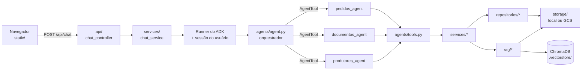

# Estrutura do projeto Sabor da Terra

Este documento explica como o projeto está organizado, qual é a função de cada pasta e arquivo, e como as partes se comunicam. É o material de referência para apresentar a arquitetura.

**Legenda:** `[OK]` implementado e testado · `[ESQ]` esqueleto (cabeçalho documentado, sem lógica; hoje só os controllers REST opcionais e o `gcs_storage.py`). Status conferido em 19/11/2026 contra o código (ver também `docs/ARQUITETURA_E_DECISOES_TECNICAS.md`).

---

## 1. Princípios da arquitetura

1. **Separação de responsabilidades.** Cada pasta tem um papel único: receber requisições, definir contratos de dados, aplicar regras, raciocinar com IA, buscar em documentos, acessar dados, guardar arquivos.
2. **Regra de dependência: cada camada só conhece a de baixo.**

   ```text
   api  →  services  →  agents  →  tools  →  services  →  repositories / rag  →  storage
   ```

   Na prática: a camada web não sabe como o agente raciocina, o agente não sabe que existe HTTP, e **nada fora de `storage/` conhece caminhos físicos de arquivos**.
3. **O LLM interpreta; o código verifica.** O modelo entende "30kg de queijo coalho e umas caixas de goiaba pra sexta". Conferir se o produto está em safra ou se a quantidade cabe nos produtores é função de código determinístico (`services/`). Assim os alertas exigidos pelo enunciado não dependem do humor do modelo.
4. **Armazenamento atrás de uma interface.** A troca de disco local por Google Cloud Storage é feita por configuração, sem mexer em agentes ou serviços.
5. **Escopo acadêmico.** Só existe o que tem função definida. Sem abstrações que o problema não pede.

---

## 2. Árvore completa

```text
sabor-da-terra/
├── .env.example                          [OK] Modelo das variáveis de ambiente
├── .gitignore                            [OK] Protege .env, .venv e o índice vetorial
├── main.py                               [OK] App FastAPI: rotas e frontend
├── pyproject.toml                        [OK] Dependências e config do pytest
├── README.md                             [OK] Apresentação do projeto
├── agents/                               [OK] Agentes do Google ADK (isolado da web)
│   ├── agent.py                              [OK] root_agent: orquestrador (AgentTool)
│   ├── modelo.py                             [OK] Escolha do modelo Gemini
│   ├── prompts.py                            [OK] Instruções dos agentes
│   ├── tools.py                              [OK] Ferramentas de pedidos (documentos e produtores pendentes)
│   └── subagents/                            [OK] Especialistas
│       ├── documentos_agent.py                   [OK] Agente de Documentos
│       ├── pedidos_agent.py                      [OK] Agente de Pedidos
│       └── produtores_agent.py                   [OK] Agente de Produtores
├── api/                                  [OK] Camada HTTP
│   ├── chat_controller.py                    [OK] POST /api/chat
│   ├── documentos_controller.py              [ESQ] Rotas de documentos (opcional)
│   ├── health_controller.py                  [OK] GET /api/health
│   ├── pedidos_controller.py                 [ESQ] Rotas de pedidos (opcional)
│   └── produtores_controller.py              [ESQ] Rotas de produtores (opcional)
├── data/                                 [OK] Dados da cooperativa
│   ├── financeiro.csv                        [OK] Transações set-out/2026
│   ├── lotes.csv                             [OK] Rastreabilidade
│   ├── pedidos.json                          [OK] 15 pedidos
│   ├── produtores.csv                        [OK] 18 produtores
│   ├── README.md                             [OK] Arquivos esperados e situação
│   ├── sazonalidade.csv                      [OK] Disponibilidade por mês
│   ├── tabela_precos_outubro_2026.csv        [OK] Preços vigentes
│   ├── certificacoes/                        [OK] Certificações e laudos
│   ├── contratos/                            [OK] Contratos
│   └── fichas_tecnicas/                      [OK] Fichas técnicas
├── docs/                                 [OK] Documentação
│   ├── ARQUITETURA_E_DECISOES_TECNICAS.md    [OK] Arquitetura, diagramas e decisões
│   ├── AGENTES_E_TRIAGEM.md                  [OK] Agentes, ferramentas e triagem em detalhe
│   ├── CONTRATOS_ARQUITETURAIS.md            [OK] Contratos entre camadas (Murilo)
│   ├── CONEXAO_BACKEND.md                    [OK] Conexão frontend ↔ backend (Raquel)
│   ├── DADOS.md                              [OK] Dicionário de dados (Arthur)
│   ├── ESTRUTURA.md                          [OK] Este documento
│   ├── PLANO_DE_TAREFAS.md                   [OK] Plano e checklist da equipe
│   ├── QA_CHECKLIST.md, TESTE_USABILIDADE.md [OK] QA da interface
│   ├── Relatorio_Frontend_Raquel.docx        [OK] Relatório do frontend (binário)
│   └── evidencias/                           [OK] Capturas de tela do QA
├── models/                               [OK] Contratos de dados (Pydantic)
│   ├── chat_model.py                         [OK] Requisição/resposta do chat
│   ├── documento_model.py                    [OK] Trecho, fonte e resposta documental
│   ├── health_model.py                       [OK] Resposta do health
│   ├── pedido_model.py                       [OK] Pedido bruto e estruturado
│   ├── produto_model.py                      [OK] Produto, sazonalidade, preço, lote
│   ├── produtor_model.py                     [OK] Produtor e financeiro
│   └── relatorio_model.py                    [OK] Resumo e notificação
├── rag/                                  [OK] Consulta documental
│   ├── chunker.py                            [OK] Divisão em trechos
│   ├── document_loader.py                    [OK] PDF/DOCX → texto + metadados
│   ├── ingestion.py                          [OK] Pipeline de indexação
│   ├── retriever.py                          [OK] Busca top-k com fonte
│   └── vector_store.py                       [OK] ChromaDB e embeddings
├── repositories/                         [OK] Acesso a dados estruturados
│   ├── document_repository.py                [OK] Documentos das 3 pastas
│   ├── financeiro_repository.py              [OK] financeiro.csv
│   ├── lote_repository.py                    [OK] lotes.csv
│   ├── pedido_repository.py                  [OK] pedidos.json
│   ├── produto_repository.py                 [OK] sazonalidade e preços
│   ├── produtor_repository.py                [OK] produtores.csv
│   └── storage_repository.py                 [OK] Parsing genérico de CSV/JSON
├── services/                             [OK] Regras de negócio
│   ├── chat_service.py                       [OK] Runner do ADK e sessão
│   ├── triagem_service.py                    [OK] Prazo, urgência, tipo e ausências da triagem
│   ├── documento_service.py                  [OK] Resposta com fontes e lotes
│   ├── pedido_service.py                     [OK] Validações da triagem
│   ├── produtor_service.py                   [OK] Cadastro, pedidos e financeiro
│   └── relatorio_service.py                  [OK] Dados de resumos e notificações
├── static/                               [OK] Frontend
│   ├── index.html                            [OK] Página
│   ├── css/                                  [OK]
│   │   └── style.css                             [OK] Estilos (fundo branco, tema claro, verde)
│   ├── img/                                  [OK]
│   │   └── folhas.svg                            [OK] Ilustração decorativa de fundo
│   └── js/                                   [OK]
│       └── app.js                                [OK] Lógica do frontend
├── storage/                              [OK] Onde os arquivos ficam
│   ├── base.py                               [OK] Interface Storage
│   ├── gcs_storage.py                        [ESQ] Google Cloud Storage
│   └── local_storage.py                      [OK] Disco local
├── tests/                                [OK] Testes (ver docs/ARQUITETURA_E_DECISOES_TECNICAS.md, seção 14)
│   ├── llm_simulado.py                       [OK] LLM roteirizado para testar agentes sem chamar o Gemini
│   ├── test_agents_*.py                      [OK] Prompts, ferramentas, orquestração, documentos e produtores
│   ├── test_api.py                           [OK] API, estáticos, docs, contrato do chat
│   ├── test_chat_integracao.py               [OK] API → chat_service → agentes → serviços (LLM simulado)
│   ├── test_chunker.py, test_ingestion.py    [OK] RAG: chunking e ingestão
│   ├── test_document_repository_loader.py    [OK] Acervo real, repositório de documentos e loader
│   ├── test_documentos.py                    [OK] Consulta documental (2 casos ignorados com motivo)
│   ├── test_estrutura.py                     [OK] Todos os módulos importam
│   ├── test_frontend_estatico.py             [OK] Arquivos estáticos, tema e decoração
│   ├── test_models_dados.py                  [OK] Modelos contra os dados reais
│   ├── test_pedidos.py, test_triagem_service.py [OK] Validação e triagem determinísticas
│   ├── test_produtores.py                    [OK] Produtores e relatórios
│   ├── test_repositories_dados.py            [OK] Repositórios de dados
│   ├── test_retriever*.py, test_vector_store.py [OK] Recuperação e armazenamento vetorial
│   └── test_storage*.py                      [OK] Storage e parsing de CSV/JSON
├── qa/                                   [OK] Ferramentas de QA da interface (Raquel)
│   ├── mock_server.py                        [OK] Servidor simulado do chat (sem backend)
│   ├── test_logica.js                        [OK] Testes da lógica do frontend (node)
│   └── verificar_backend.py                  [OK] Verificador de contrato contra o backend real
└── utils/                                [OK] Transversal
    ├── config.py                             [OK] Configuração centralizada
    └── logger.py                             [OK] Logging
```

`__init__.py` (um por pacote Python, com a descrição da camada) e `.gitkeep` (mantêm pastas vazias no Git) foram omitidos da árvore.

### O que foi adicionado ou esclarecido em relação à estrutura original

| Item | Por quê |
|---|---|
| `models/produto_model.py`, `repositories/produto_repository.py` | `sazonalidade.csv` e `tabela_precos_outubro_2026.csv` não tinham modelo nem repositório |
| `repositories/lote_repository.py` | `lotes.csv` (rastreabilidade) não tinha repositório |
| `models/documento_model.py` | O enunciado exige citar a fonte de cada resposta documental, o que pede um modelo para fonte e trecho |
| `api/health_controller.py`, `models/health_model.py` | Endpoint `/api/health` |
| `storage/base.py` | Interface `Storage`, o contrato que local e GCS cumprem |
| `agents/subagents/__init__.py` | Torna `subagents` um pacote importável |
| `tests/test_storage.py`, `tests/test_estrutura.py` | Testam o storage e garantem que todos os módulos importam |
| `docs/`, `data/README.md` | Documentação |
| `repositories/storage_repository.py` (mantido, papel esclarecido) | Não duplica `storage/`: aqui está o **parsing** de CSV/JSON, lá estão os **backends** de armazenamento |

---

## 3. O caminho de uma mensagem



1. O navegador envia a mensagem para `POST /api/chat`.
2. `chat_controller` valida o corpo e entrega ao `chat_service`.
3. `chat_service` recupera a sessão do usuário (é ela que mantém o contexto da conversa) e executa o orquestrador.
4. O orquestrador decide qual especialista chamar, ou vários, e combina as respostas.
5. O especialista usa **ferramentas** (`tools.py`), que chamam **serviços**.
6. Os serviços buscam dados em **repositórios** ou trechos em **rag/**; ambos leem arquivos pela interface `Storage`.
7. A resposta volta pelo mesmo caminho, junto com a lista de agentes acionados.

---

## 4. Pasta por pasta

### Raiz do projeto

| Arquivo | Responsabilidade |
|---|---|
| `main.py` `[OK]` | Cria o app FastAPI, registra as rotas e serve o frontend. Ponto de entrada: `uvicorn main:app --reload` |
| `pyproject.toml` `[OK]` | Dependências: núcleo + extras opcionais (`ai`, `rag`, `gcs`, `dev`), instalados só quando a etapa correspondente chegar |
| `.env.example` `[OK]` | Modelo das variáveis de ambiente. O `.env` real nunca vai ao Git |
| `.gitignore` `[OK]` | Protege `.env`, `.venv`, o índice vetorial e arquivos temporários |
| `README.md` `[OK]` | Apresentação do projeto |

### `api/`: camada HTTP

**Função:** receber requisições, validar a entrada e devolver JSON. É a única camada que conhece FastAPI.
**Chama:** `services/` e `models/`. **É chamada por:** `main.py`.
**Não deve conter:** regra de negócio nem acesso a dados.

| Arquivo | Responsabilidade |
|---|---|
| `health_controller.py` `[OK]` | `GET /api/health`: verifica se a aplicação está no ar |
| `chat_controller.py` `[OK]` | `POST /api/chat`: porta de entrada da conversa |
| `pedidos_controller.py` `[ESQ]` | Rotas REST de pedidos. **Opcional**: só se a interface precisar |
| `documentos_controller.py` `[ESQ]` | Consulta documental direta e reindexação. **Opcional** |
| `produtores_controller.py` `[ESQ]` | Consulta de produtores e resumos. **Opcional** |

### `models/`: contratos de dados

**Função:** schemas Pydantic que descrevem o formato dos dados que circulam entre as camadas. Validam tipos e geram a documentação automática em `/docs`.
**Não deve conter:** lógica. Nem depender de `services/` ou `agents/`.

| Arquivo | Responsabilidade |
|---|---|
| `health_model.py` `[OK]` | Resposta do `/api/health` |
| `chat_model.py` `[OK]` | Requisição e resposta do chat (user_id, sessão, mensagem; answer, agentes acionados, fontes) |
| `pedido_model.py` `[OK]` | Pedido bruto e pedido estruturado: itens, prazo, comprador, tipo, urgência, alertas |
| `produtor_model.py` `[OK]` | Produtor e transação financeira |
| `produto_model.py` `[OK]` | Produto, sazonalidade, preço e lote |
| `documento_model.py` `[OK]` | Trecho recuperado, fonte e resposta documental |
| `relatorio_model.py` `[OK]` | Resumo individual do produtor e notificação |

Os campos dos modelos de dados serão definidos **a partir das colunas reais** dos arquivos da cooperativa, e não de suposições.

### `services/`: regras de negócio

**Função:** o "o que o sistema sabe fazer". Orquestra repositórios e RAG para responder perguntas de negócio.
**Chama:** `repositories/`, `rag/`. **É chamada por:** `api/` e `agents/tools.py`.
**Não deve conter:** HTTP, nem prompts, nem acesso direto a arquivos.

| Arquivo | Responsabilidade |
|---|---|
| `chat_service.py` `[OK]` | Liga a API ao agente: executa o Runner do ADK mantendo a sessão |
| `triagem_service.py` `[OK]` | Resolve prazos, classifica urgência e tipo e registra informações ausentes; usa o `pedido_service` |
| `pedido_service.py` `[OK]` | Validações da triagem: safra, capacidade, urgência, tipo, ambiguidades |
| `documento_service.py` `[OK]` | Consulta documental com fontes e "evidência insuficiente" (limiar de distância 0,30). **Rastreabilidade de lotes: pendente** |
| `produtor_service.py` `[OK]` | Cadastro, pedidos e financeiro de um produtor |
| `relatorio_service.py` `[OK]` | Dados do resumo individual e da notificação |

### `agents/`: o "cérebro" (Google ADK)

**Função:** tudo que é do ADK. É um pacote **isolado**: não conhece HTTP.
**Chama:** `services/` (via `tools.py`). **É chamado por:** `chat_service`.

| Arquivo | Responsabilidade |
|---|---|
| `agent.py` `[OK]` | `root_agent`: orquestrador que registra os 3 especialistas como `AgentTool` |
| `prompts.py` `[OK]` | Instruções dos agentes, separadas do código |
| `tools.py` `[OK]` | Funções Python tipadas e com docstring que o modelo pode chamar. Finas: chamam um serviço |
| `subagents/pedidos_agent.py` `[OK]` | Interpreta pedidos em português coloquial |
| `subagents/documentos_agent.py` `[OK]` | Responde com base nos documentos, citando fontes |
| `subagents/produtores_agent.py` `[OK]` | Gera resumos e redige notificações |

A docstring de cada ferramenta é o que o modelo lê para decidir quando usá-la. Por isso é parte do comportamento do sistema, não só documentação.

### `rag/`: consulta documental

**Função:** transformar PDFs e DOCX em um índice pesquisável e recuperar os trechos relevantes para uma pergunta.
**Chama:** `repositories/document_repository`. **É chamada por:** `services/documento_service`.

| Arquivo | Responsabilidade |
|---|---|
| `document_loader.py` `[OK]` | PDF/DOCX → texto + metadados (arquivo, tipo, página) |
| `chunker.py` `[OK]` | Divide o texto em trechos preservando a origem |
| `vector_store.py` `[OK]` | **Único** módulo que conhece o ChromaDB e os embeddings |
| `retriever.py` `[OK]` | Busca os trechos mais relevantes (top-k), com fonte e score |
| `ingestion.py` `[OK]` | Pipeline completo: listar → carregar → dividir → embeddings → gravar. Executável como comando e repetível |

Fluxo de **construção do índice** (offline, por comando): `ingestion` → `document_repository` → `document_loader` → `chunker` → `vector_store`.
Fluxo de **consulta** (a cada pergunta): `documento_service` → `retriever` → `vector_store`.

### `repositories/`: acesso a dados estruturados

**Função:** transformar CSV e JSON em objetos Python. Os serviços pedem "os produtores que vendem mel", não "leia a coluna 4 do CSV".
**Chama:** `storage`. **É chamada por:** `services/`.
**Não deve conter:** regra de negócio.

| Arquivo | Fonte | Responsabilidade |
|---|---|---|
| `storage_repository.py` `[OK]` | (genérico) | Parsing de CSV/JSON via `Storage`, compartilhado pelos demais |
| `produtor_repository.py` `[OK]` | `produtores.csv` | Listar e buscar produtores |
| `pedido_repository.py` `[OK]` | `pedidos.json` | Listar e buscar pedidos (somente leitura na v1) |
| `financeiro_repository.py` `[OK]` | `financeiro.csv` | Transações e pendências por produtor |
| `produto_repository.py` `[OK]` | `sazonalidade.csv`, `tabela_precos_outubro_2026.csv` | Safra e preços |
| `lote_repository.py` `[OK]` | `lotes.csv` | Rastreabilidade |
| `document_repository.py` `[OK]` | `certificacoes/`, `contratos/`, `fichas_tecnicas/` | Lista e entrega os bytes dos documentos |

Trocar CSV/JSON por um banco de dados no futuro significa reescrever **apenas** estes arquivos.

### `storage/`: onde os arquivos ficam

**Função:** esconder *onde* os arquivos estão. Todos acessam por **chave lógica** (`contratos/mercado_bom_preco.pdf`), nunca por caminho.
**Escolha do backend:** variável `STORAGE_BACKEND` (`local` ou `gcs`).

| Arquivo | Responsabilidade |
|---|---|
| `base.py` `[OK]` | Interface `Storage`: `exists`, `read_bytes`, `read_text`, `list_keys` |
| `local_storage.py` `[OK]` | Implementação em disco; bloqueia chaves que saem da pasta de dados (`../`) |
| `__init__.py` `[OK]` | Fábrica `get_storage()`, que escolhe o backend pela configuração |
| `gcs_storage.py` `[ESQ]` | Implementação para Google Cloud Storage. Contrato definido, corpo pendente |

### `data/`: dados da cooperativa

Arquivos CSV/JSON e documentos fictícios fornecidos no enunciado (6 estruturados e 20 documentos em `certificacoes/`, `contratos/` e `fichas_tecnicas/`). Veja `data/README.md` e `docs/DADOS.md`. Nada aqui é inventado nem editado.

### `static/`: frontend

HTML5, CSS3 e JavaScript puro. Chat conectado a `POST /api/chat`, com sugestões, estados de carregamento e erro, sessão preservada no navegador, fontes e agentes acionados. Visual: fundo branco, tema sempre claro e acentos verdes.

| Arquivo | Responsabilidade |
|---|---|
| `index.html` `[OK]` | Estrutura da página |
| `css/style.css` `[OK]` | Estilos |
| `js/app.js` `[OK]` | Consulta `/api/health` e implementa o chat (envio, sessão, erros, fontes) |
| `img/folhas.svg` `[OK]` | Ilustração decorativa de fundo (só telas largas) |

### `utils/`: transversal

| Arquivo | Responsabilidade |
|---|---|
| `config.py` `[OK]` | **Única** leitura das variáveis de ambiente, tipada. Resolve caminhos absolutos. Chaves ficam mascaradas |
| `logger.py` `[OK]` | Logging padronizado (`get_logger(__name__)`) |

### `tests/`

| Arquivo | O que verifica |
|---|---|
| `test_api.py` `[OK]` | `/api/health`, página inicial, estáticos, documentação automática |
| `test_storage.py` `[OK]` | Leitura, listagem, erros e bloqueio de `../` |
| `test_estrutura.py` `[OK]` | Todos os módulos da estrutura existem e importam |
| `test_agents_*.py`, `llm_simulado.py` `[OK]` | Agentes com LLM simulado: ferramentas reais, `Runner` real, só o modelo é roteirizado |
| `test_chat_integracao.py` `[OK]` | Fluxo API → `chat_service` → agentes → serviços → repositórios, erros 422/429/502/503, sessão |
| `test_pedidos.py`, `test_triagem_service.py`, `test_produtores.py` `[OK]` | Regras determinísticas com os dados reais |
| `test_documentos.py`, `test_document_repository_loader.py` `[OK]` | Consulta documental e acervo real; 2 casos ignorados (índice real; lotes) |
| `test_chunker.py`, `test_ingestion.py`, `test_vector_store.py`, `test_retriever*.py` `[OK]` | Pipeline de RAG (qualidade com índice real só com `RUN_RETRIEVER_QUALITY=1`) |

---

## 5. Como agentes, serviços e repositórios conversam

Exemplo com o pedido do enunciado: *"preciso de 30kg de queijo coalho e umas caixas de goiaba pra sexta"*.

1. O **orquestrador** reconhece um pedido e chama o **Agente de Pedidos**.
2. O agente (LLM) extrai o que o texto diz: queijo coalho, 30 kg; goiaba, em caixas, quantidade não informada; prazo "sexta".
3. Ele chama uma **ferramenta** de validação (`tools.py`) com esses dados já estruturados.
4. A ferramenta chama o `pedido_service`, que consulta `produto_repository` (safra) e `produtor_repository` (capacidade). Tudo em código, sem LLM.
5. O serviço devolve um resultado verificável: alertas (ex.: produto fora de safra), informações ausentes (quantidade de caixas), urgência.
6. O agente redige a resposta para a equipe, apontando o que falta.

**Ponto de atenção:** "sexta" só vira uma data se o agente souber a data de hoje. A data atual precisa ser fornecida ao agente (prompt ou ferramenta); o modelo não a conhece.

---

## 6. Como o sistema acessa arquivos locais

```text
DATA_DIR (.env)  →  Settings.data_path (caminho absoluto)  →  LocalStorage(root)
                                                                     ▲
repositories / rag  ──  get_storage().read_text("pasta/arquivo.csv")─┘
```

- `DATA_DIR` é resolvido para caminho absoluto, então o servidor funciona de qualquer pasta.
- Quem precisa de um arquivo pede por **chave lógica** relativa à raiz dos dados, sempre com `/`.
- `LocalStorage` recusa chaves que escapam da raiz (ex.: `../.env`), o que é testado.

---

## 7. Migração futura para a nuvem

Mover o sistema para a nuvem envolve **quatro peças diferentes**, e o GCS resolve só a primeira.

| Peça | Hoje (local) | Na nuvem | Esforço |
|---|---|---|---|
| Arquivos (CSV, JSON, PDF, DOCX) | `LocalStorage` | `GCSStorage` com `STORAGE_BACKEND=gcs` | Baixo: implementar um arquivo |
| Índice vetorial | ChromaDB em `.vectorstore/` | Reconstruir pela ingestão a partir do GCS, ou persistir o ChromaDB em disco/volume do serviço | Médio. **O GCS não substitui o banco vetorial** |
| Sessões (contexto) | Em memória | Sessão persistente (o ADK oferece serviço de sessão em banco; no diagrama de referência é o Firestore) | Médio |
| Logs | `logger.py` | Cloud Logging | Baixo |

A escolha entre as opções do índice vetorial será feita na fase do RAG.

---

## 8. Requisitos do enunciado → componentes

| Requisito (PDF) | Componente |
|---|---|
| Interface conversacional por texto | `static/` + `POST /api/chat` |
| Processar pedidos em português coloquial, com abreviações e erros | `agents/subagents/pedidos_agent.py` |
| Extrair produtos, quantidades, prazos e comprador; classificar por tipo e urgência | Agente de Pedidos + `pedido_service` |
| Sinalizar produto fora de safra e quantidade acima da capacidade | `pedido_service` (código determinístico) |
| Responder sobre o acervo indicando o documento de origem | `rag/` + `documento_service` + `models/documento_model.py` |
| Dizer claramente quando não souber, sem inventar | Limiar de evidência no `documento_service` + regras em `prompts.py` |
| Rastreabilidade de lote | `lote_repository` + `documento_service` (**pendente**: nenhum agente consulta `lotes.csv` ainda) |
| Gerar relatórios e notificações de forma autônoma | `relatorio_service` + Agente de Produtores |
| Manter o contexto ao longo da sessão | Sessão por usuário em `chat_service` |

---

## 9. Decisões e alternativas

| Decisão | Alternativa considerada | Por que esta |
|---|---|---|
| Orquestrador com `AgentTool` | `sub_agents` (transferência de controle) | Perguntas reais cruzam especialistas (ex.: disponibilidade e certificação de um produto) e o orquestrador precisa combinar as respostas. Limitação: o especialista recebe só o texto da chamada, não o histórico inteiro |
| Camadas `agents → tools → services → repositories → storage` | Tools lendo os arquivos direto | Troca de armazenamento e de fonte de dados sem tocar nos agentes; serviços testáveis sem LLM |
| LLM interpreta, código valida | Deixar o LLM decidir safra e capacidade | Confiabilidade: os alertas exigidos pelo enunciado não podem variar de uma execução para outra |
| CSV/JSON via repositórios | Banco de dados (SQLite) | Escopo acadêmico e dados pequenos. Os repositórios permitem trocar depois |
| ChromaDB local | Serviço vetorial gerenciado | Simples para rodar localmente. Migração planejada como peça própria |
| Controllers REST de pedidos/documentos/produtores opcionais | Criá-los todos agora | O fluxo principal passa pelo chat; só se cria o que a interface usar |
| Frontend em JavaScript puro | Framework (React) | Exigência do escopo inicial e menos dependências |

---

## 10. Limitações conhecidas

- **Sessão em memória:** reiniciar o servidor apaga o contexto das conversas.
- **Sem autenticação:** adequado ao protótipo, não à produção.
- **Pedidos somente leitura:** o resultado da triagem aparece no chat, mas não é gravado.
- **Qualidade do RAG depende do chunking e dos embeddings**, que serão calibrados com os documentos reais.
- **Erros semânticos de extração:** os serviços detectam inconsistências de fato (safra, capacidade), mas não conseguem saber se o LLM entendeu o pedido errado.
- **Notificações só são redigidas**, não enviadas.
- **Free Tier do Gemini:** limite baixo de requisições por minuto; o chat devolve 429 amigável quando é atingido.
- **Índice vetorial não versionado:** cada máquina precisa rodar `python -m rag.ingestion` (usa a API de embeddings); sem ele o Agente de Documentos responde "evidência insuficiente".
- **Rastreabilidade de lotes** ainda não é coberta por nenhum agente.

## 11. Decisões em aberto

| Decisão | Situação | Depende de |
|---|---|---|
| Modelo Gemini (`MODEL`) | `gemini-3.5-flash-lite` (confirmado na documentação oficial e validado com chamadas reais) | — |
| Modelo de embeddings | Em uso: `gemini-embedding-001` (`rag/vector_store.py`); disponibilidade na conta não verificada | Rawan |
| Tamanho e sobreposição dos chunks | Valores atuais em `rag/chunker.py`; não calibrados com índice real | Rawan |
| Valores de "tipo" e "urgência" de pedido | Proposta implementada em `services/triagem_service.py` | Murilo e equipe |
| Limiar para "evidência insuficiente" | 0,30 (o mesmo dos testes do retriever); não calibrado | Rawan |
| Nomes dos campos do chat | `user_id`/`answer` implementados; documento de contratos usa `user`/`message` como exemplo | Murilo |
| Persistir pedidos processados | Em aberto | Decisão do projeto |
| Quais controllers REST opcionais ativar | Nenhum ativado; a interface só usa `POST /api/chat` | Necessidade da interface |

---|---|
| Modelo Gemini (`MODEL`) | Escolha na lista vigente do AI Studio |
| Modelo de embeddings | Qualidade com os documentos reais e custo |
| Tamanho e sobreposição dos chunks | Teste com os documentos reais |
| Valores de "tipo" e "urgência" de pedido | Análise de `pedidos.json` |
| Limiar para "evidência insuficiente" | Teste com perguntas reais |
| Persistir pedidos processados | Decisão do projeto |
| Quais controllers REST opcionais ativar | Necessidade da interface |

---

## 12. Fases de desenvolvimento

| Fase | Entrega | Situação |
|---|---|---|
| 1 | Fundação: FastAPI, configuração, `/api/health`, storage local, frontend mínimo | Concluída |
| 2 | Estrutura completa e documentação | Concluída |
| 3 | Dados, modelos e repositórios (CSV/JSON) | Concluída |
| 4 | Orquestrador, Agente de Pedidos e API de chat | Implementada e testada (LLM simulado); validada com o Gemini real em 5 cenários |
| 5 | RAG e Agente de Documentos | Código implementado e testado; **índice vetorial não construído** e agente não validado com o Gemini real |
| 6 | Agente de Produtores, relatórios e notificações | Implementada e testada (LLM simulado); não validada com o Gemini real |
| 7 | Interface de chat conectada à API | Implementada; QA manual pendente (ver `docs/QA_CHECKLIST.md`) |
| Futuro | GCS, Docker, proteções de entrada e saída | Fora do escopo atual |
