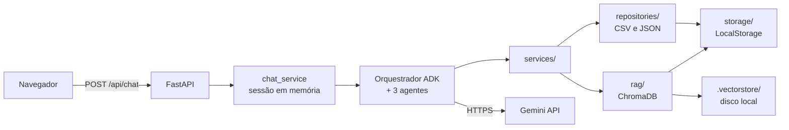
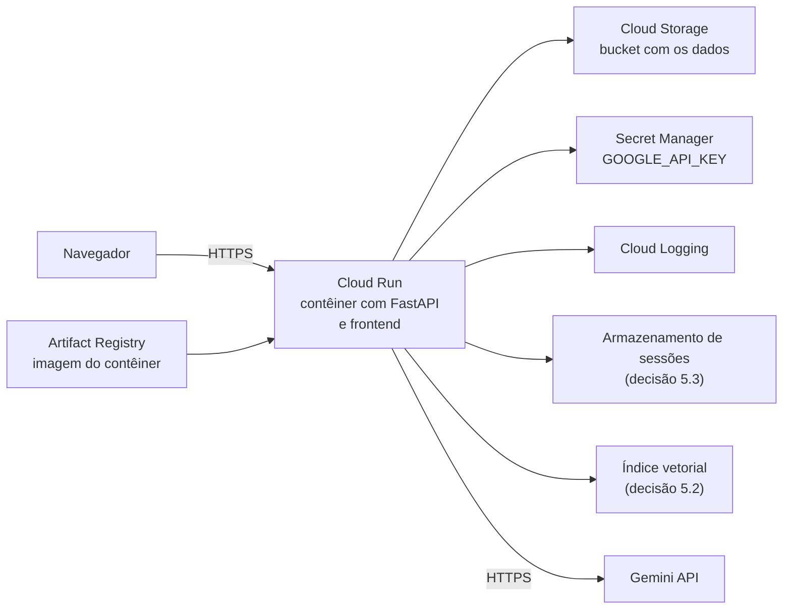

# Proposta de implantação do Sabor da Terra na nuvem (Google Cloud)

Data: 19/11/2026
Situação: proposta. Nada descrito aqui foi implementado ou criado na nuvem.

## 1. Objetivo

Este documento explica como o assistente Sabor da Terra poderia sair do computador da equipe e rodar na nuvem, de modo que a cooperativa o acessasse por um endereço na internet. Ele descreve a arquitetura proposta, o que precisa mudar no código, as decisões que a equipe ainda tem de tomar e uma ordem de trabalho para a migração.

A proposta usa o Google Cloud porque o projeto já depende do Gemini e do Google ADK, e porque o código foi organizado desde o começo para essa troca: o armazenamento fica atrás de uma interface (`storage/base.py`) e a configuração é lida em um único lugar (`utils/config.py`).

## 2. Como o sistema funciona hoje

A aplicação é um único processo Python. O FastAPI recebe as mensagens em `POST /api/chat`, entrega para o `chat_service`, que executa o orquestrador do ADK com seus três agentes (pedidos, documentos e produtores). O mesmo processo serve o frontend de `static/`, então não há CORS nem um segundo servidor.



Quatro coisas ficam no computador de quem executa o projeto, e cada uma vira uma pergunta na hora de ir para a nuvem:

| O que | Onde está hoje | Pergunta para a nuvem |
|---|---|---|
| Arquivos da cooperativa (CSV, JSON, TXT, PDF, DOCX) | pasta `data/`, via `LocalStorage` | onde guardar e como ler |
| Índice vetorial | ChromaDB em `.vectorstore/` | onde ele vive, já que o disco do serviço não é permanente |
| Sessões de conversa | memória do processo (`InMemorySessionService`) | como não perder o contexto quando o serviço reinicia |
| Chave do Gemini e logs | arquivo `.env` e saída do `logger.py` | onde guardar o segredo e onde ler os logs |

## 3. Arquitetura proposta



A ideia é manter a aplicação como ela é, empacotada em um contêiner, e trocar apenas os pontos de contato com o disco e com o segredo.

**Cloud Run** executa o contêiner. Ele atende a interface web e a API no mesmo endereço, escala conforme o uso e pode ir a zero instâncias quando ninguém está usando. A cooperativa recebe de 60 a 100 pedidos por dia, um volume que não exige servidor ligado o tempo todo.

**Cloud Storage** guarda os arquivos que hoje estão em `data/`, mantendo as mesmas chaves lógicas (`contratos/...`, `certificacoes/...`, `lotes.csv`). Como o sistema só lê esses dados (pedidos são somente leitura nesta versão), a conta do serviço precisa apenas de permissão de leitura.

**Secret Manager** guarda a `GOOGLE_API_KEY`. O Cloud Run injeta o segredo como variável de ambiente, e o `utils/config.py` continua lendo do mesmo jeito. O `.env` deixa de existir no ambiente de produção.

**Cloud Logging** recebe o que o `logger.py` já escreve na saída padrão. O projeto já evita registrar o conteúdo das mensagens, o que continua valendo.

**Artifact Registry** armazena a imagem do contêiner que o Cloud Run executa.

## 4. O que muda no código

A lista é curta porque a estrutura em camadas já isolou o que depende de disco.

1. **Implementar `storage/gcs_storage.py`.** Hoje o arquivo é um esqueleto que lança `NotImplementedError`. Ele precisa cumprir os quatro métodos de `storage/base.py` (`exists`, `read_bytes`, `read_text`, `list_keys`), somando `GCS_PREFIX` ao nome do objeto. Um esboço:

   ```python
   from google.cloud import storage

   class GCSStorage:
       def __init__(self, bucket: str, prefix: str = "") -> None:
           self._bucket = storage.Client().bucket(bucket)
           self._prefix = prefix.strip("/")

       def _name(self, key: str) -> str:
           return f"{self._prefix}/{key}" if self._prefix else key

       def exists(self, key: str) -> bool:
           return self._bucket.blob(self._name(key)).exists()

       def read_bytes(self, key: str) -> bytes:
           blob = self._bucket.blob(self._name(key))
           if not blob.exists():
               raise FileNotFoundError(key)
           return blob.download_as_bytes()

       def read_text(self, key: str, encoding: str = "utf-8") -> str:
           return self.read_bytes(key).decode(encoding)

       def list_keys(self, prefix: str = "") -> list[str]:
           base = self._name(prefix) if prefix else self._prefix
           blobs = self._bucket.client.list_blobs(self._bucket, prefix=base)
           cut = len(self._prefix) + 1 if self._prefix else 0
           return sorted(b.name[cut:] for b in blobs if not b.name.endswith("/"))
   ```

   O esboço é uma base, não código pronto: falta tratar o prefixo vazio com cuidado, ignorar `.gitkeep` como o `LocalStorage` faz e escrever testes equivalentes aos de `tests/test_storage.py`.

2. **Atualizar `storage/__init__.py`.** O `get_storage()` hoje recusa `STORAGE_BACKEND=gcs` com uma mensagem. Ele passa a devolver `GCSStorage(settings.gcs_bucket, settings.gcs_prefix)`, exigindo `GCS_BUCKET`.
3. **Criar um `Dockerfile`.** O repositório ainda não tem um. Ele instala o projeto com os extras `ai`, `rag` e `gcs` (`pip install ".[ai,rag,gcs]"`), usa Python 3.12 e inicia o Uvicorn escutando na porta que o Cloud Run informa pela variável `PORT`.
4. **Sessões.** O `chat_service` já aceita um `session_service` por parâmetro no construtor, então trocar o serviço em memória por um persistente não obriga a reescrever o serviço. Os detalhes estão na decisão 5.3.
5. **Índice vetorial.** O `rag/vector_store.py` grava em `VECTOR_STORE_DIR`. Dependendo da decisão 5.2, esse trecho muda ou fica como está.

Os agentes, os serviços de negócio, a triagem e o frontend não precisam de alteração.

## 5. Decisões que a equipe precisa tomar

### 5.1 Onde hospedar a aplicação

| Opção | Vantagens | Desvantagens |
|---|---|---|
| Cloud Run (proposta) | Sem servidor para administrar, escala sozinho, paga-se pelo uso, aceita contêiner | Disco temporário, e mais de uma instância pode estar no ar ao mesmo tempo |
| Máquina virtual (Compute Engine) | Disco persistente, comportamento parecido com o computador local | A equipe cuida de atualizações, reinício e segurança do sistema |
| App Engine | Também sem servidor | Menos flexível para dependências como o ChromaDB; pouca vantagem sobre o Cloud Run aqui |

A recomendação é o Cloud Run, pelo volume baixo e pela facilidade. A contrapartida precisa ficar clara no documento: como o disco é temporário e várias instâncias podem coexistir, o índice vetorial e as sessões não podem ficar só em arquivos e memória do processo.

### 5.2 Onde fica o índice vetorial

O `.vectorstore/` é um artefato derivado: dá para reconstruí-lo rodando a ingestão sobre os documentos. O comentário do próprio `vector_store.py` já registra que o GCS guarda os arquivos, não o índice. Há três caminhos.

| Opção | Como funciona | Prós | Contras |
|---|---|---|---|
| A. Reconstruir na subida | Ao iniciar, a instância lê os documentos do bucket e roda a ingestão | Nenhum componente novo | Cada partida gasta chamadas de embedding, a partida fica lenta e uma cota excedida (já aconteceu um 429 nos testes) pode impedir o serviço de ficar pronto |
| B. Instantâneo no bucket | A ingestão roda uma vez, quando os documentos mudam, e a pasta do índice é copiada para o bucket; cada instância baixa o instantâneo ao iniciar | Partida rápida, sem chamadas de embedding em produção | Um passo manual ou automatizado a mais para atualizar o índice |
| C. Banco vetorial gerenciado | Trocar o ChromaDB por um serviço da nuvem | Índice compartilhado e persistente | Reescrever o `vector_store.py`, mais custo, exagero para 52 trechos |

Para a primeira versão, a opção A é a mais simples e basta para a demonstração (20 documentos, 52 trechos). Se o serviço for usado de verdade, a B é o próximo passo natural. A C só se justificaria com uma base de documentos muito maior.

### 5.3 Onde ficam as sessões

Com o `InMemorySessionService`, cada instância tem a sua própria memória. Quando o Cloud Run reinicia ou cria uma segunda instância, o usuário perde o contexto ou cai em uma sessão nova.

| Opção | Observação |
|---|---|
| Manter em memória, limitando o serviço a uma instância | Funciona para uma demonstração. O contexto ainda se perde a cada reinício ou quando o serviço escala a zero |
| Serviço de sessão do ADK com banco de dados | O ADK oferece um serviço de sessão em banco; exigiria um banco gerenciado (por exemplo, Cloud SQL) |
| Serviço de sessão gerenciado do ADK na nuvem | Tira a administração do banco da equipe, mas prende o projeto a mais um serviço do Google Cloud |
| Firestore | É o que aparece no diagrama de referência do enunciado; exigiria uma implementação própria do serviço de sessão |

A escolha depende de quanto a continuidade da conversa importa. Para demonstrar, aceitar a perda de contexto e documentar a limitação é defensável, porque o projeto já a lista. Para uso real, é preciso um armazenamento persistente.

### 5.4 Qual API do Gemini usar

Hoje o projeto usa a chave do Google AI Studio (`GOOGLE_API_KEY`), e a documentação em `docs/AGENTES_E_TRIAGEM.md` pede para não misturá-la com credenciais do Google Cloud. Na nuvem há dois caminhos: manter a chave guardada no Secret Manager, que não exige mudança no código, ou migrar para o Gemini via Vertex AI, que usa a identidade da conta de serviço em vez de uma chave, mas muda a configuração dos agentes e do `vector_store.py`. A recomendação é manter a chave na primeira versão e registrar a migração como evolução.

## 6. Segurança

- A chave do Gemini fica no Secret Manager, nunca na imagem do contêiner nem no repositório. O `.env` e o `.gitignore` já seguem esse princípio localmente.
- O Cloud Run roda com uma conta de serviço própria, com a permissão mínima necessária: leitura no bucket e acesso ao segredo. Nada além disso.
- O sistema hoje não tem autenticação. Isso não é um problema em um computador local, mas em um endereço público qualquer pessoa poderia usar o assistente e consumir a cota do Gemini. Antes de abrir o acesso, é preciso restringi-lo, por exemplo exigindo login do Google no próprio Cloud Run (IAP) ou usando um serviço de identidade. Essa decisão precisa estar no plano, mesmo que fique para depois da demonstração.
- Os dados da cooperativa são fictícios no projeto. Em uma cooperativa real haveria dados pessoais de produtores (e o tratamento exigido pela LGPD), o que reforça a necessidade do controle de acesso.

## 7. Custos

Não há valores neste documento. Os preços mudam e dependem da região e do uso, então o cálculo deve ser feito na calculadora oficial do Google Cloud (https://cloud.google.com/products/calculator) com as premissas abaixo.

Serviços que geram cobrança: Cloud Run (tempo de CPU e memória e número de requisições), Cloud Storage (armazenamento e operações de leitura), Artifact Registry (armazenamento da imagem), Secret Manager (segredos e acessos), Cloud Logging (volume de logs acima da cota gratuita), o banco de sessões, se for escolhido um, e o uso do Gemini (tokens dos agentes e embeddings).

Premissas de uso a informar na calculadora: de 60 a 100 pedidos por dia, número de usuários simultâneos (poucos funcionários da cooperativa), volume dos dados (alguns megabytes), região do serviço e quantas mensagens por conversa chegam ao modelo. O maior custo variável provavelmente será o Gemini, não a infraestrutura.

## 8. Plano de migração

1. Criar o projeto no Google Cloud, definir quem tem acesso e configurar um alerta de orçamento antes de qualquer outro recurso.
2. Criar o bucket e enviar o conteúdo de `data/`, mantendo a estrutura de pastas.
3. Implementar o `GCSStorage`, atualizar o `get_storage()` e escrever os testes. Validar localmente apontando `STORAGE_BACKEND=gcs` para o bucket.
4. Escrever o `Dockerfile` e rodar o contêiner na máquina local, conferindo o `/api/health` e uma conversa completa.
5. Publicar a imagem no Artifact Registry, criar o segredo da `GOOGLE_API_KEY` e fazer o primeiro deploy no Cloud Run.
6. Aplicar a decisão do índice vetorial (5.2) e verificar que o Agente de Documentos responde com fontes.
7. Aplicar a decisão das sessões (5.3) e testar um reinício do serviço no meio de uma conversa.
8. Restringir o acesso (seção 6), conferir os logs no Cloud Logging e registrar como voltar para a versão anterior caso algo falhe.

A ordem importa: as etapas 3 e 4 podem ser feitas e testadas sem criar nada além do bucket, o que reduz o risco de custos inesperados no começo.

## 9. Riscos e limitações

- Cota e limite do Gemini: o serviço já trata o erro 429 com uma mensagem amigável, mas uma cota baixa continua sendo o ponto mais frágil, sobretudo se o índice for reconstruído a cada partida.
- Partida a frio: se o serviço escalar a zero, a primeira requisição depois de um período ocioso é mais lenta, e mais ainda se o índice precisar ser reconstruído.
- Sem autenticação: ver a seção 6.
- Pedidos somente leitura e notificações apenas redigidas: a nuvem não muda essas limitações, e o bucket ficaria somente leitura. Se os pedidos passarem a ser gravados, será preciso um banco de dados, não apenas o Cloud Storage.
- Esta proposta não foi testada na nuvem. Os nomes de serviços, permissões e opções do ADK devem ser conferidos na documentação oficial vigente antes da implementação.